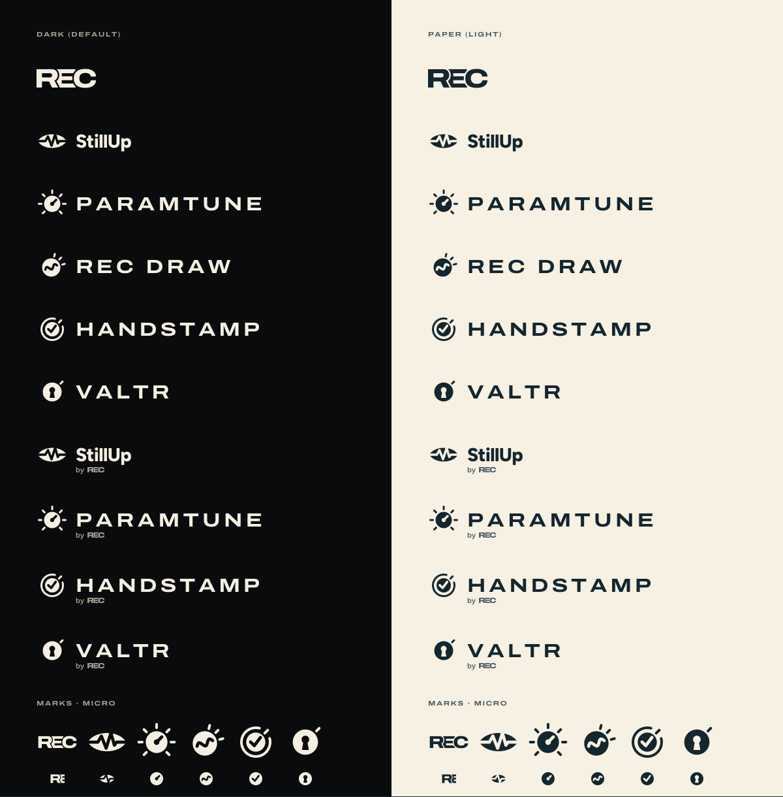
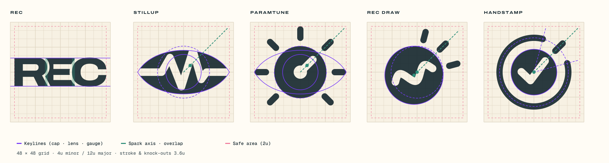
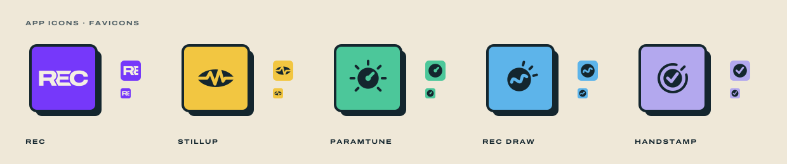
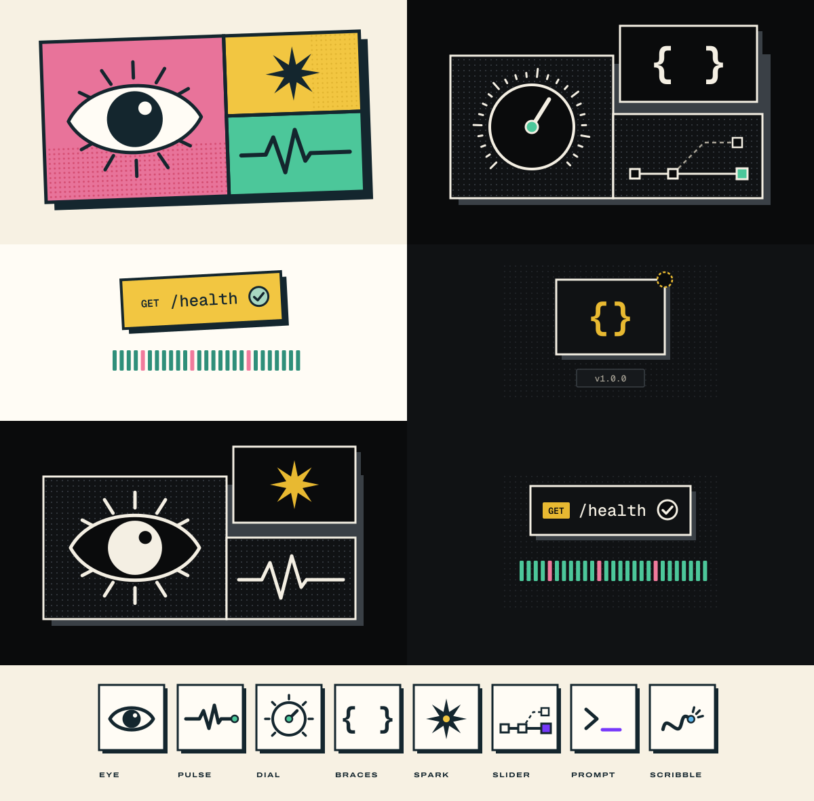

---
# Machine-readable tokens in the DESIGN.md format (github.com/google-labs-code/design.md).
# These values are the source of truth: scripts/check.py checks §3, §14 and build.py against them.
# The format has no themes, so colors are primitives and `-light` components cover the Paper theme.
version: alpha  # DESIGN.md format version, not the brand version (see the header below)
name: REC Design System
description: One design DNA for every R.E.C. product (Paramtune, StillUp, Handstamp, Valtr, Rec Draw). Dark by default, Paper light theme, purple for action, one signature accent per product.
colors:
  # Roles (dark default). The full per-theme mapping is §3.3.
  primary: "{colors.purple-500}"
  secondary: "{colors.cream}"
  neutral: "{colors.ink-950}"
  white: "#FFFFFF"
  black: "#000000"
  # Ink (dark neutrals)
  ink-950: "#0A0B0C"
  ink-900: "#101214"
  ink-850: "#16191C"
  ink-800: "#1D2125"
  ink-700: "#23272B"
  ink-600: "#3A4046"
  ink-500: "#555C63"
  # Paper (light neutrals)
  paper-50: "#FFFCF5"
  paper-100: "#F7F1E3"
  paper-200: "#EFE8D8"
  paper-300: "#E5DDCB"
  paper-400: "#DDD3BF"
  paper-500: "#CFC4AD"
  # Text neutrals
  cream: "#F4EFE3"
  stone-400: "#A8A396"
  stone-500: "#8A867E"
  slate-600: "#4B5B61"
  slate-500: "#5F6B67"
  # Deep (Reciam teal-navy)
  deep-900: "#14262E"
  deep-800: "#1B323C"
  deep-700: "#25424E"
  deep-300: "#A9B8B9"
  # REC Purple
  purple-50: "#F2EDFF"
  purple-100: "#E4D9FF"
  purple-200: "#CBB6FF"
  purple-300: "#AC8BFF"
  purple-400: "#8E5FFF"
  purple-500: "#7638FA"
  purple-600: "#6524E8"
  purple-700: "#521BC2"
  purple-800: "#40179A"
  purple-900: "#2C1169"
  purple-950: "#1A0A40"
  # Pastel signals
  sun-100: "#FBEFC4"
  sun-300: "#F2C641"
  sun-400: "#E8B931"
  sun-500: "#D9A514"
  sun-600: "#7A5A00"
  sun-950: "#241F10"
  mint-100: "#D6EEE3"
  mint-300: "#A8D8C2"
  mint-400: "#4CC79A"
  mint-500: "#2F8F7A"
  mint-600: "#1C6B53"
  mint-950: "#10221B"
  rose-100: "#FBE3E8"
  rose-300: "#F2C9D1"
  rose-400: "#F07A9C"
  rose-500: "#E8739A"
  rose-600: "#C42F52"
  rose-950: "#26121A"
  lilac-100: "#EEEBF7"
  lilac-300: "#DCD7EE"
  lilac-400: "#B3A8EE"
  lilac-600: "#5B4FA8"
  lilac-950: "#1A1828"
  sky-100: "#E2F0FA"
  sky-300: "#B4DAF2"
  sky-400: "#5DB4EA"
  sky-600: "#1E5F8C"
  sky-950: "#0E1C25"
  clay-100: "#FBE6D6"
  clay-300: "#F4C3A0"
  clay-400: "#EE9A62"
  clay-600: "#9A4515"
  clay-950: "#26160C"
typography:
  display-hero:
    fontFamily: Figtree
    fontSize: 4.5rem
    fontWeight: 800
    lineHeight: 0.95
    letterSpacing: -0.04em
  title-1:
    fontFamily: Figtree
    fontSize: 3.5rem
    fontWeight: 800
    lineHeight: 1
    letterSpacing: -0.035em
  title-2:
    fontFamily: Figtree
    fontSize: 1.75rem
    fontWeight: 800
    lineHeight: 1.15
    letterSpacing: -0.02em
  heading:
    fontFamily: Figtree
    fontSize: 1.25rem
    fontWeight: 700
    lineHeight: 1.25
    letterSpacing: -0.01em
  subheading:
    fontFamily: Figtree
    fontSize: 1rem
    fontWeight: 700
    lineHeight: 1.35
    letterSpacing: -0.005em
  body-lg:
    fontFamily: Figtree
    fontSize: 1rem
    fontWeight: 400
    lineHeight: 1.55
  body:
    fontFamily: Figtree
    fontSize: 0.875rem
    fontWeight: 400
    lineHeight: 1.5
  body-sm:
    fontFamily: Figtree
    fontSize: 0.8125rem
    fontWeight: 400
    lineHeight: 1.45
  caption:
    fontFamily: Figtree
    fontSize: 0.75rem
    fontWeight: 500
    lineHeight: 1.4
  stat-xl:
    fontFamily: Archivo
    fontSize: 4rem
    fontWeight: 800
    lineHeight: 1
    fontVariation: "'wdth' 125"
  stat:
    fontFamily: Archivo
    fontSize: 2.5rem
    fontWeight: 800
    lineHeight: 1
    fontVariation: "'wdth' 125"
  stat-sm:
    fontFamily: Archivo
    fontSize: 1.5rem
    fontWeight: 800
    lineHeight: 1
    fontVariation: "'wdth' 125"
  wordmark:
    fontFamily: Archivo
    fontSize: 1.125rem
    fontWeight: 700
    lineHeight: 1
    letterSpacing: 0.18em
    fontVariation: "'wdth' 125"
  eyebrow:
    fontFamily: Archivo
    fontSize: 0.6875rem
    fontWeight: 700
    lineHeight: 1.2
    letterSpacing: 0.14em
    fontVariation: "'wdth' 125"
  label:
    fontFamily: Archivo
    fontSize: 0.6875rem
    fontWeight: 700
    lineHeight: 1.2
    letterSpacing: 0.1em
    fontVariation: "'wdth' 125"
  mono:
    fontFamily: Geist Mono
    fontSize: 0.8125rem
    fontWeight: 400
    lineHeight: 1.5
  mono-sm:
    fontFamily: Geist Mono
    fontSize: 0.75rem
    fontWeight: 400
    lineHeight: 1.45
  code:
    fontFamily: Geist Mono
    fontSize: 0.8125rem
    fontWeight: 400
    lineHeight: 1.6
rounded:
  none: 0px
  xs: 2px
  sm: 4px
  md: 6px
  full: 9999px
spacing:
  # Keys are the §5.1 tokens; "0.5" and "1.5" are written 0-5 and 1-5 so they export as CSS names.
  "0-5": 2px
  "1": 4px
  "1-5": 6px
  "2": 8px
  "3": 12px
  "4": 16px
  "5": 20px
  "6": 24px
  "8": 32px
  "10": 40px
  "12": 48px
  "16": 64px
  "24": 96px
components:
  # Dark theme is the default; `-light` entries are the Paper theme (§3.3).
  button-primary:
    backgroundColor: "{colors.purple-500}"
    textColor: "{colors.white}"
    typography: "{typography.body}"
    rounded: "{rounded.sm}"
    height: "36px"
    padding: "14px"
  button-primary-hover:
    backgroundColor: "{colors.purple-400}"
    textColor: "{colors.white}"
  button-primary-light:
    backgroundColor: "{colors.purple-600}"
    textColor: "{colors.white}"
    typography: "{typography.body}"
    rounded: "{rounded.sm}"
    height: "36px"
    padding: "14px"
  button-primary-hover-light:
    backgroundColor: "{colors.purple-700}"
    textColor: "{colors.white}"
  button-danger:
    backgroundColor: "#D23758"
    textColor: "{colors.white}"
    typography: "{typography.body}"
    rounded: "{rounded.sm}"
    height: "36px"
    padding: "14px"
  button-danger-light:
    backgroundColor: "{colors.rose-600}"
    textColor: "{colors.white}"
    typography: "{typography.body}"
    rounded: "{rounded.sm}"
    height: "36px"
    padding: "14px"
  page:
    backgroundColor: "{colors.ink-950}"
    textColor: "{colors.cream}"
    typography: "{typography.body}"
  page-light:
    backgroundColor: "{colors.paper-100}"
    textColor: "{colors.deep-900}"
    typography: "{typography.body}"
  text-muted:
    backgroundColor: "{colors.ink-950}"
    textColor: "{colors.stone-400}"
  text-muted-light:
    backgroundColor: "{colors.paper-100}"
    textColor: "{colors.slate-600}"
  text-subtle:
    backgroundColor: "{colors.ink-850}"
    textColor: "{colors.stone-500}"
  text-subtle-light:
    backgroundColor: "{colors.paper-200}"
    textColor: "{colors.slate-500}"
  link:
    backgroundColor: "{colors.ink-900}"
    textColor: "{colors.purple-300}"
  link-light:
    backgroundColor: "{colors.paper-100}"
    textColor: "{colors.purple-600}"
  error-text-light:
    backgroundColor: "{colors.paper-100}"
    textColor: "{colors.rose-600}"
  error-text:
    backgroundColor: "{colors.ink-950}"
    textColor: "{colors.rose-400}"
  success-text-light:
    backgroundColor: "{colors.paper-100}"
    textColor: "{colors.mint-600}"
  warning-text-light:
    backgroundColor: "{colors.paper-100}"
    textColor: "{colors.sun-600}"
  sidebar-light:
    backgroundColor: "{colors.deep-900}"
    textColor: "{colors.cream}"
  sidebar-muted-light:
    backgroundColor: "{colors.deep-900}"
    textColor: "{colors.deep-300}"
  tile-mint:
    backgroundColor: "{colors.mint-950}"
    textColor: "{colors.cream}"
    typography: "{typography.stat}"
    rounded: "{rounded.none}"
  tile-mint-light:
    backgroundColor: "{colors.mint-300}"
    textColor: "{colors.deep-900}"
    typography: "{typography.stat}"
    rounded: "{rounded.none}"
  tile-sun:
    backgroundColor: "{colors.sun-950}"
    textColor: "{colors.cream}"
    typography: "{typography.stat}"
    rounded: "{rounded.none}"
  tile-sun-light:
    backgroundColor: "{colors.sun-300}"
    textColor: "{colors.deep-900}"
    typography: "{typography.stat}"
    rounded: "{rounded.none}"
  tile-rose:
    backgroundColor: "{colors.rose-950}"
    textColor: "{colors.cream}"
    typography: "{typography.stat}"
    rounded: "{rounded.none}"
  tile-rose-light:
    backgroundColor: "{colors.rose-300}"
    textColor: "{colors.deep-900}"
    typography: "{typography.stat}"
    rounded: "{rounded.none}"
  tile-lilac:
    backgroundColor: "{colors.lilac-950}"
    textColor: "{colors.cream}"
    typography: "{typography.stat}"
    rounded: "{rounded.none}"
  tile-lilac-light:
    backgroundColor: "{colors.lilac-300}"
    textColor: "{colors.deep-900}"
    typography: "{typography.stat}"
    rounded: "{rounded.none}"
  tile-sky:
    backgroundColor: "{colors.sky-950}"
    textColor: "{colors.cream}"
    typography: "{typography.stat}"
    rounded: "{rounded.none}"
  tile-sky-caption:
    backgroundColor: "{colors.sky-950}"
    textColor: "{colors.stone-400}"
  tile-sky-light:
    backgroundColor: "{colors.sky-300}"
    textColor: "{colors.deep-900}"
    typography: "{typography.stat}"
    rounded: "{rounded.none}"
  tile-clay:
    backgroundColor: "{colors.clay-950}"
    textColor: "{colors.cream}"
    typography: "{typography.stat}"
    rounded: "{rounded.none}"
  tile-clay-caption:
    backgroundColor: "{colors.clay-950}"
    textColor: "{colors.stone-400}"
  tile-clay-light:
    backgroundColor: "{colors.clay-300}"
    textColor: "{colors.deep-900}"
    typography: "{typography.stat}"
    rounded: "{rounded.none}"
  accent-text-draw:
    backgroundColor: "{colors.ink-950}"
    textColor: "{colors.sky-400}"
  accent-text-draw-light:
    backgroundColor: "{colors.paper-100}"
    textColor: "{colors.sky-600}"
  accent-text-valtr:
    backgroundColor: "{colors.ink-950}"
    textColor: "{colors.clay-400}"
  accent-text-valtr-light:
    backgroundColor: "{colors.paper-100}"
    textColor: "{colors.clay-600}"
  nav-active-paramtune:
    backgroundColor: "{colors.mint-400}"
    textColor: "{colors.ink-950}"
    rounded: "{rounded.sm}"
    height: "40px"
  nav-active-paramtune-light:
    backgroundColor: "{colors.mint-300}"
    textColor: "{colors.deep-900}"
    rounded: "{rounded.sm}"
    height: "40px"
  nav-active-stillup:
    backgroundColor: "{colors.sun-400}"
    textColor: "{colors.ink-950}"
    rounded: "{rounded.sm}"
    height: "40px"
  nav-active-stillup-light:
    backgroundColor: "{colors.sun-300}"
    textColor: "{colors.deep-900}"
    rounded: "{rounded.sm}"
    height: "40px"
  nav-active-handstamp:
    backgroundColor: "{colors.lilac-400}"
    textColor: "{colors.ink-950}"
    rounded: "{rounded.sm}"
    height: "40px"
  nav-active-handstamp-light:
    backgroundColor: "{colors.lilac-300}"
    textColor: "{colors.deep-900}"
    rounded: "{rounded.sm}"
    height: "40px"
  nav-active-draw:
    backgroundColor: "{colors.sky-400}"
    textColor: "{colors.ink-950}"
    rounded: "{rounded.sm}"
    height: "40px"
  nav-active-draw-light:
    backgroundColor: "{colors.sky-300}"
    textColor: "{colors.deep-900}"
    rounded: "{rounded.sm}"
    height: "40px"
  nav-active-valtr:
    backgroundColor: "{colors.clay-400}"
    textColor: "{colors.ink-950}"
    rounded: "{rounded.sm}"
    height: "40px"
  nav-active-valtr-light:
    backgroundColor: "{colors.clay-300}"
    textColor: "{colors.deep-900}"
    rounded: "{rounded.sm}"
    height: "40px"
---

# REC Design System

> **Version** 1.8.0 · **Owner** RECIAM SAS · **Last updated** 2026-10-11
> One design DNA for every REC product: **Paramtune**, **StillUp**, **Handstamp**, **Valtr**, **Rec Draw**, and whatever comes next.

---

## Table of contents

1. [Principles](#1-principles)
2. [Brand architecture](#2-brand-architecture)
3. [Color](#3-color)
4. [Typography](#4-typography)
5. [Spacing, sizing & layout](#5-spacing-sizing--layout)
6. [Shape, borders & depth](#6-shape-borders--depth)
7. [Iconography](#7-iconography)
8. [Illustration](#8-illustration)
9. [Motion](#9-motion)
10. [Components](#10-components)
11. [Patterns & page templates](#11-patterns--page-templates)
12. [Voice & tone](#12-voice--tone)
13. [Accessibility](#13-accessibility)
14. [Implementation: Tailwind v4](#14-implementation-tailwind-v4)
15. [Do & don't](#15-do--dont)
16. [Review checklist](#16-review-checklist)
17. [Changelog](#17-changelog)

---

## 1. Principles

REC combines two parents. **Paramtune** contributes precision: black canvas, monospace data, hairline borders, expanded uppercase labels. **StillUp / Reciam** contributes warmth: cream paper, purple, pastel status colors, chunky offset shadows, and a playful voice. Every rule in this doc comes down to the five principles below.

| # | Principle | What it means in practice |
|---|-----------|---------------------------|
| 1 | **Calm by default, loud on purpose** | Surfaces are flat and quiet. Color, offset shadows and illustration are kept for what matters: the primary action, the active place, the headline numbers. |
| 2 | **Data speaks mono** | Anything a machine produced (versions, IDs, paths, timestamps, counts, code) is set in mono. Anything a person wrote is set in sans. |
| 3 | **Labels are stamps** | Section labels and eyebrows are short, uppercase, expanded and widely tracked. They work like labels on a hardware panel. |
| 4 | **Warm words, exact facts** | The voice is friendly and a bit playful. The information is still precise. A joke never replaces a number. |
| 5 | **One system, many accents** | Every product shares the same tokens, components and layout. A product only changes its **signature accent** and its wordmark. |

**Theme default: dark.** Every product ships dark first. Light ("Paper") is a full, supported theme and never an afterthought.

---

## 2. Brand architecture

```
REC  (master brand of RECIAM SAS · chain monogram · purple)
├── Paramtune   — config & schema management      · signature: Mint
├── StillUp     — API uptime & health checks      · signature: Sun
├── Handstamp   — passwordless OpenID Connect     · signature: Lilac
├── Valtr       — secrets per project & env       · signature: Clay
├── Rec Draw    — private whiteboard & sketching  · signature: Sky
└── <future>    — Rose is the only pastel left, and it reads as failure: add a new hue (§2.10 step 9)
```

### 2.1 Master brand: REC

- **Name:** REC is the founder's initials: **R**odrigo **E**spinosa **C**urbelo. It does not mean "record". In running text, write **R.E.C.** or the full name, so it never reads like a camera's recording label. The legal name stays **RECIAM SAS** in footers, invoices and legal copy.
- **Mark:** the chain. R, E and C in Display Expanded 800 (see §4), with the E tucked just behind R and C (§2.4). The chain is both symbol and wordmark; there is no separate icon. Use it as the app icon, the loading glyph, and in the "by REC" lockup.
- **Brand color:** REC Purple (`purple-500` / `purple-600`).
- **The purple period.** Page titles end with a period in purple. This is the single most recognizable REC detail. Use it on page titles (H1) and hero headlines only.

### 2.2 Product brands

| Product | Wordmark | Signature accent | Used for |
|---------|----------|------------------|----------|
| Paramtune | `PARAMTUNE`, Display Expanded 700, tracking `0.18em` | **Mint** | active nav, required-field marker, "configured" states, product illustration accent |
| StillUp | `StillUp`, Heading Sans 800, tracking `-0.02em` | **Sun** | active nav, count badges, product illustration accent |
| Handstamp | `HANDSTAMP`, Display Expanded 700, tracking `0.16em` | **Lilac** | active nav, product identity |
| Valtr | `VALTR`, Display Expanded 700, tracking `0.16em` | **Clay** | active nav, product identity |
| Rec Draw | `REC DRAW`, Display Expanded 700, tracking `0.16em` | **Sky** | active nav, the selected tool, product illustration accent |

Rules:

- The product wordmark sits top-left in the sidebar or top bar. The sidebar footer carries the lockup `<product> · by REC` (the chain at 8px cap height) and the version in mono, e.g. `StillUp v0.1.0`.
- The **signature accent is never the action color.** Buttons, links and focus rings are always purple. The accent marks *where you are* and *what this product is about*. It does not mark *what you can do*.
- Paramtune and StillUp have different wordmark treatments on purpose. Inherited equity is fine. A new product should default to the Paramtune treatment (expanded uppercase).
- **Accents that double as status.** Mint (healthy), Sun (attention), Lilac (pending/info) are also status colors (§3.2). Inside its own product the accent still means *place*, and status keeps its second signal (icon or word, §3.5 rule 4), so the two never get confused. Lilac is Handstamp's accent in the same way Mint is Paramtune's. Sky is the first accent with no status meaning: it is Rec Draw's only. Clay is the second: it is Valtr's only.
- **Why `REC DRAW` and not `DRAW`.** The product is called Rec Draw, and a lone uppercase verb in Archivo Expanded reads like a button label ("DRAW") rather than a name, and is too generic to own. `REC DRAW` keeps the full name and sits at about the same length as `PARAMTUNE`. Tracking is `0.16em` (not `0.18em`) so the two words hold together across the word space. Because the name already carries REC, Rec Draw has **no endorsed lockup** ("REC DRAW by REC" would stutter). Its sidebar footer still shows the chain and the version in mono, e.g. `Rec Draw v0.1.0`.

### 2.3 The logo family at a glance



Every logo comes from one generator, [`build.py`](build.py). All source files are in [`logos/`](logos/). Wordmarks are converted to outlines, so the SVGs render the same without the fonts installed.

| Asset | Files (`-ink` for light backgrounds, `-cream` for dark) |
|-------|------------------------------------------------------------|
| Mark | `rec-mark-*.svg` · `stillup-mark-*.svg` · `paramtune-mark-*.svg` · `draw-mark-*.svg` (Rec Draw) · `handstamp-mark-*.svg` · `valtr-mark-*.svg` |
| Micro mark (≤32px) | `*-micro-ink.svg` · `*-micro-cream.svg` |
| Horizontal lockup | `*-lockup-ink.svg` · `*-lockup-cream.svg` |
| Endorsed lockup | `stillup-endorsed-*.svg` · `paramtune-endorsed-*.svg` · `handstamp-endorsed-*.svg` · `valtr-endorsed-*.svg` (none for Rec Draw, see §2.2) |
| App icon (128) | `*-app-icon.svg` |
| Favicon (32) | `*-favicon.svg` |

### 2.4 Mark construction



**The REC chain** (master brand) is typographic, built from Archivo letterforms rather than drawn primitives:

| Part | Spec |
|------|------|
| **Letters** | R, E, C in Archivo, wdth 125, weight 800. No tracking. |
| **Overlap** | The E slides **10% of the cap height** behind the R and behind the C. |
| **Cut** | Where they overlap, R and C cut an **8.5% of cap height** gap into the E. The gap is a knock-out (transparent), never a drawn outline. |
| **Stacking** | R and C are always in front and the E is always behind. Never weave the letters or bring the E forward. |
| **On the 48 grid** | Fitted to the 44u safe width and centred vertically (cap height ≈ 13.5u). The chain is about 3.25 : 1. |

**Product marks** are built on the same **48 × 48 unit grid** from three shared primitives:

| Primitive | Geometry (in grid units) | Meaning |
|-----------|--------------------------|---------|
| **Lens** | Almond 44 × 21, centred. Path `M2 24 C10 10 38 10 46 24 C38 38 10 38 2 24 Z` | Watching, attention |
| **Pupil / Gauge** | Circle centred at (24, 24): r 8.5 as a pupil cut-out, r 12.5 as a solid gauge disc | Focus, measurement |
| **Spark** | The highlight. It always sits on the **45° up-right axis** from the centre. | Insight, "something's alive" |

And the same rules:

1. **Solid shapes with knock-outs.** Marks are one flat color. Detail is *cut out* (made transparent), never drawn in a second color, so the mark works on any background.
2. **One line weight.** Knock-outs and strokes are **3.6u** (3u for gauge ticks). Corners and caps are round.
3. **Safe area 2u.** Nothing crosses x/y = 2 or 46.
4. **The spark points up-right.** The Paramtune pointer and the accent in illustrations lean toward 45°. This shared gesture is what ties the family together.
5. **One primitive + one product motif.** StillUp is Lens + Pulse (the eye *watching* a heartbeat). Paramtune is Gauge + Ticks + pointer on the Spark axis (the pupil *grown into* a dial). Rec Draw is Gauge + Scribble + Spark (a pen stroke drawn across the disc, rising toward a spark). Handstamp is Gauge + Check + Seal (the stamp's impression, vouching that you're in). Valtr is Gauge + Keyhole + Spark (a vault door, keeping what you store locked away).

**Rec Draw construction.** Drawing *makes* things on a canvas you control, so it takes the **Gauge** (the hand on the dial), not the Lens (which only watches). The disc is r **14** (between Paramtune's 12.5 and the 14.5 it was cut down from, because Rec Draw has 3 ticks instead of 7 and a longer knock-out). The motif is a **scribble**: 1.5 periods of a sine wave, 19u long, amplitude 3u, rising at 20°, cut 3.6u through the disc. It stays inside the disc so the disc reads as one piece. The **spark** is three 3u ticks from r 17.5 to 21.5 at 75°, 45° and 15°, fanned round the 45° axis: the moment an idea lands. Because all the outside detail is up-right, the disc sits **1.5u down-left along the spark axis**, at (22.5, 25.5), so the mark centres optically on the grid. Ink coverage is within 1% of Paramtune's.

**Handstamp construction.** Handstamp *vouches* for people: it's the stamp on your hand that lets you into every R.E.C. app. It takes the **Gauge**, because it decides who gets in rather than watching. The disc is r **11**, the impression, with a **check** cut 3.6u through it: short arm down to a vertex just below-left of centre, long arm up to r 7.6 on the 45° spark axis. Round it runs the stamp's **rim**, a 3u stroke at r **16.5**, broken from 15° to 75° around the spark axis. In the break sits the **spark**, one 3u tick from r 14.5 to 19.5 at 45°, which the check's long arm points at. The disc is smaller than Paramtune's because the rim carries weight; ink coverage is within 5% of Paramtune's and Rec Draw's.

**Valtr construction.** Valtr *stores* secrets and hands them out only to whoever holds the key, so it takes the **Gauge**: the disc is a vault door. The disc is r **14.5**, with a **keyhole** cut through it: a round head r **4.4** at (24, 21) and a slot below it, a trapezoid 3.6u wide under the head and 6.8u wide at y 32.5, cut with a 1u round-joined edge so its corners are soft. The keyhole stays upright, because a tilted keyhole reads as a mistake, so the gesture up-right comes from the **spark**: one 3u tick from r 18 to 22.5 at 45°, as on Handstamp. With no ring of ticks round it, the disc grows past Paramtune's 12.5 to match its weight; ink coverage is within 1% of Paramtune's and Rec Draw's.

### 2.5 Lockups

| Lockup | Construction |
|--------|--------------|
| **Horizontal** (default) | Mark 48 · gap 12 (0.25 × mark) · wordmark with cap height 20 (≈ 0.42 × mark). The caps are vertically centred on the mark. **REC** has no separate mark, so its lockup is the chain alone at cap height 28, centred in the same 48 band. |
| **Endorsed** (product + "by REC") | Horizontal lockup, then **9 below the wordmark baseline**: `by` (Figtree 600) + the REC chain, both with cap height 8, in `fg-muted`, left-aligned with the wordmark. |
| **Stacked** (square spaces, splash screens) | Mark at 2× the wordmark cap height × 2.4, centred above the wordmark, gap 0.5 × cap height. Build it from the same parts. Don't stretch the horizontal file. |

Wordmark specs:

| Brand | Font | Weight | Tracking | Case |
|-------|------|--------|----------|------|
| REC (chain) | Archivo, wdth 125 | 800 | none (letters overlap 10%, see §2.4) | UPPER |
| PARAMTUNE | Archivo, wdth 125 | 700 | `0.18em` | UPPER |
| StillUp | Figtree | 800 | `-0.02em` | Camel (kept for existing brand recognition) |
| REC DRAW | Archivo, wdth 125 | 700 | `0.16em` | UPPER |
| HANDSTAMP | Archivo, wdth 125 | 700 | `0.16em` | UPPER |
| VALTR | Archivo, wdth 125 | 700 | `0.16em` | UPPER |
| *Future product* | Archivo, wdth 125 | 700 | `0.14–0.18em` | UPPER |

### 2.6 Clear space, sizes and micro marks

- **Clear space** around any lockup equals the wordmark's cap height (the height of the "E" in the REC chain).
- **Minimum sizes:** full mark 20px (the REC chain 40px wide), horizontal lockup 96px wide, endorsed lockup 160px wide.
- **Micro marks** below 32px: REC switches to the R with the E behind it, cropped to the safe square. This is a first pass and still needs a hand-tuned 16px drawing. StillUp switches to a single bold peak cut 5u thick. Paramtune drops its ticks and becomes a solid disc with a 5.5u pointer. Rec Draw drops its spark ticks and becomes a centred r 20 disc with a bolder scribble (26u long, amplitude 4.2u, cut 5u), which still reads as a pen line at 16px. Handstamp drops the rim and spark and becomes a r 20 disc with a 5.5u check whose long arm still ends on the 45° axis. Valtr drops its spark and becomes a r 20 disc with the keyhole scaled up (head r 6.4, slot 5u at the top), which still reads as a keyhole at 16px. Use the micro marks for favicons, tab icons, 16–24px avatars and status-bar icons.



### 2.7 App icons

- 104 × 104 tile inside a 128 canvas, `rx 10` (the one place larger than §6.1's 6px max, because OS icon masks need it), 4u `deep-900` outline, plus an **8px offset shadow** in `deep-900`. It's the offset-shadow DNA at icon scale.
- Tile fill: **REC** `purple-500` with a cream mark · **StillUp** `sun-300` with an ink mark · **Paramtune** `mint-400` with an ink mark · **Rec Draw** `sky-400` with an ink mark · **Handstamp** `lilac-400` with an ink mark · **Valtr** `clay-400` with an ink mark. In general: the product's signature accent with an ink mark.
- Mark at 64 (50% of canvas), centred on the tile. The REC chain is wide, so it sits at 84 to fill the tile's width.
- For iOS/Android exports, flatten the shadow inside the tile mask, or drop it and keep only the outline.

### 2.8 Colorways

| Background | Mark/wordmark | Allowed |
|------------|---------------|---------|
| `ink-950` / `ink-900` | `cream` | ✅ default |
| `paper-100` / `paper-50` | `deep-900` | ✅ default |
| `deep-900` (light-theme sidebar) | `cream` | ✅ |
| Product accent tile | `deep-900` | ✅ app icons, badges |
| `purple-500` | `cream` | ✅ REC only |
| Photos / busy illustration | Place the mark on a solid `ink-950` or `paper-50` plate | ⚠️ |
| Any gradient, or purple mark on purple | none | ❌ |

### 2.9 Misuse

❌ Do not:

- stretch, skew or rotate marks. Illustrations may tilt ±2°, logos never.
- outline a solid mark, or add strokes, drop shadows or glows. The offset shadow belongs to app icons only.
- fill knock-outs with a second color, or recolor the spark alone.
- rebuild a wordmark in a different font or tracking, or set it in live text.
- combine two product marks, or place a product mark inside the REC chain.
- change the chain's overlap or cut, bring the E forward, weave the letters, or recolor one letter.
- use the REC chain as decoration or a bullet. It's a signature, not an ornament.
- write the brand as a bare "REC" in running text. Use R.E.C. or the full name.

### 2.10 How to create a logo for a new REC product

1. **Name the verb.** One word for what the product does for people: *watch* (StillUp), *tune* (Paramtune), *draw* (Rec Draw), *store* (Valtr), maybe *ship*, *notify*.
2. **Choose the base primitive.** Pick **Lens** if the product *observes* things. Pick **Gauge** (the r 12.5 disc) if it *controls or measures* things.
3. **Choose one motif** that shows the verb in 1–3 strokes. Draw from the motif kit (§8) when possible: pulse, dial, braces, slider, spark, prompt, scribble. Add a new motif only if none fits.
4. **Cut, don't draw.** Apply the motif as a 3.6u knock-out through the primitive, or as up to 8 external 3u ticks. Nothing gets a second color.
5. **Point it up-right.** The motif's key element (a peak, pointer, arrowhead, highlight) sits on the 45° spark axis.
6. **Check the grid.** Stay inside the 2u safe area, and keep the optical weight close to its siblings. Put it next to the existing marks at 64px and 20px. If it looks heavier, reduce the primitive (Paramtune's disc is 12.5, not 14.5, for exactly this reason).
7. **Make the micro mark.** Remove all detail under 3u and thicken knock-outs to 5u+. Test it at 16px.
8. **Set the wordmark.** Use Archivo wdth 125, weight 700, uppercase, tracking 0.14–0.18em. Lock it up per §2.5.
9. **Pick the signature accent** from an unused pastel. Mint, Sun, Lilac (Handstamp), Sky (Rec Draw) and Clay (Valtr) are taken, and Rose reads as failure, so add a new hue: give it the full ramp (`-100`, `-300`, `-400`, `-600`, `-950`), keep it clear of purple, and check it against the §13 contrast pairs (Sky in §13.1 is the worked example). Build the app icon per §2.7.
10. **Add it to `build.py`.** Write one `mark_<name>(fg)` and `micro_<name>(fg)` function, add entries to `MARKS`, `MICRO`, `WORDMARKS` and `ICONS`, then run the script. Never hand-edit the exported SVGs.

---

## 3. Color

### 3.1 Color model

There are three layers. Components only ever use **semantic** tokens.

1. **Primitives:** raw palettes (`ink`, `paper`, `purple`, `sun`, `mint`, `rose`, `lilac`, `sky`, `clay`, `deep`).
2. **Semantic:** role-based tokens that switch per theme (`canvas`, `surface-1`, `fg`, `fg-muted`, `border`, `primary`, `success-tile`, …).
3. **Product:** `accent`, `accent-fg`, `accent-tile`, set by `data-product`.

### 3.2 Primitives

#### Neutrals: Ink (dark theme)

| Token | Hex | Use |
|-------|-----|-----|
| `ink-950` | `#0A0B0C` | Canvas (dark) |
| `ink-900` | `#101214` | Surface 1: cards, sidebar, top bar |
| `ink-850` | `#16191C` | Surface 2: hover, raised, inputs |
| `ink-800` | `#1D2125` | Surface 3: pressed, selected rows |
| `ink-700` | `#23272B` | Hairline border |
| `ink-600` | `#3A4046` | Strong border, offset-shadow color |
| `ink-500` | `#555C63` | Disabled icons |

#### Neutrals: Paper (light theme)

| Token | Hex | Use |
|-------|-----|-----|
| `paper-50` | `#FFFCF5` | Surface 1: cards, tables |
| `paper-100` | `#F7F1E3` | Canvas (light) |
| `paper-200` | `#EFE8D8` | Surface 2: callouts, sunken areas |
| `paper-300` | `#E5DDCB` | Surface 3: pressed, selected rows |
| `paper-400` | `#DDD3BF` | Hairline border |
| `paper-500` | `#CFC4AD` | Input border |

#### Text neutrals

| Token | Hex | Theme | Role |
|-------|-----|-------|------|
| `cream` | `#F4EFE3` | dark | `fg`: primary text (the cream tint ties dark mode back to Paper) |
| `stone-400` | `#A8A396` | dark | `fg-muted`: secondary text |
| `stone-500` | `#8A867E` | dark | `fg-subtle`: meta, placeholders |
| `deep-900` | `#14262E` | light | `fg`: primary text, strong borders, offset shadows |
| `slate-600` | `#4B5B61` | light | `fg-muted` |
| `slate-500` | `#5F6B67` | light | `fg-subtle` |

#### Deep (Reciam teal-navy)

| Token | Hex | Use |
|-------|-----|-----|
| `deep-900` | `#14262E` | Light-theme sidebar, ink text, offset shadows in light |
| `deep-800` | `#1B323C` | Sidebar hover (light theme) |
| `deep-700` | `#25424E` | Sidebar borders (light theme) |
| `deep-300` | `#A9B8B9` | Muted text on Deep |

#### REC Purple: action and brand

| Token | Hex | Notes |
|-------|-----|-------|
| `purple-50`  | `#F2EDFF` | Tab active bg (light) |
| `purple-100` | `#E4D9FF` | Selection bg (light) |
| `purple-200` | `#CBB6FF` | |
| `purple-300` | `#AC8BFF` | Links on dark, focus ring on dark |
| `purple-400` | `#8E5FFF` | Hover for primary on dark |
| `purple-500` | `#7638FA` | **Primary (dark theme)**, the purple period on dark |
| `purple-600` | `#6524E8` | **Primary (light theme)**, the purple period on light, links on light |
| `purple-700` | `#521BC2` | Pressed on light |
| `purple-800` | `#40179A` | |
| `purple-900` | `#2C1169` | Tab active bg (dark) |
| `purple-950` | `#1A0A40` | Selection bg (dark) |

#### Pastel signals

Each hue has a **light tile**, a **solid** (icons, dots, strong accents) and a **dark tile** (the muted tint Paramtune uses on black).

| Hue | `-100` light soft | `-300` light tile | `-400` dark solid | `-600` text on light | `-950` dark tile | Meaning |
|-----|------|------|------|------|------|---------|
| **Sun** | `#FBEFC4` | `#F2C641` | `#E8B931` | `#7A5A00` | `#241F10` | Totals, attention, warning, StillUp accent |
| **Mint** | `#D6EEE3` | `#A8D8C2` | `#4CC79A` | `#1C6B53` | `#10221B` | Healthy, success, configured, Paramtune accent |
| **Rose** | `#FBE3E8` | `#F2C9D1` | `#F07A9C` | `#C42F52` | `#26121A` | Failing, error, destructive |
| **Lilac** | `#EEEBF7` | `#DCD7EE` | `#B3A8EE` | `#5B4FA8` | `#1A1828` | Pending, awaiting data, info, neutral-in-progress, Handstamp accent |
| **Sky** | `#E2F0FA` | `#B4DAF2` | `#5DB4EA` | `#1E5F8C` | `#0E1C25` | Rec Draw accent only. No status meaning. Hue ≈ 203°, well clear of purple (≈ 259°) and lilac (≈ 249°) |
| **Clay** | `#FBE6D6` | `#F4C3A0` | `#EE9A62` | `#9A4515` | `#26160C` | Valtr accent only. No status meaning. Hue ≈ 24°, clear of purple (≈ 259°), 21° from sun (≈ 45°) and 41° from rose (≈ 343°) |

Illustration-only extras: `rose-500 #E8739A` (hot pink panel), `mint-500 #2F8F7A` (teal pulse line), `sun-500 #D9A514`.

### 3.3 Semantic tokens

| Semantic token | Dark (default) | Light (Paper) |
|----------------|----------------|---------------|
| `canvas` | `ink-950` `#0A0B0C` | `paper-100` `#F7F1E3` |
| `surface-1` | `ink-900` `#101214` | `paper-50` `#FFFCF5` |
| `surface-2` | `ink-850` `#16191C` | `paper-200` `#EFE8D8` |
| `surface-3` | `ink-800` `#1D2125` | `paper-300` `#E5DDCB` |
| `sidebar` | `ink-900` `#101214` | `deep-900` `#14262E` |
| `sidebar-fg` | `cream` | `cream` |
| `sidebar-fg-muted` | `stone-400` | `deep-300` |
| `fg` | `cream` `#F4EFE3` | `deep-900` `#14262E` |
| `fg-muted` | `stone-400` `#A8A396` | `slate-600` `#4B5B61` |
| `fg-subtle` | `stone-500` `#8A867E` | `slate-500` `#5F6B67` |
| `border` | `ink-700` `#23272B` | `paper-400` `#DDD3BF` |
| `border-strong` | `ink-600` `#3A4046` | `deep-900` `#14262E` |
| `border-input` | `ink-600` `#3A4046` | `paper-500` `#CFC4AD` |
| `shadow-hard` | `ink-600` `#3A4046` | `deep-900` `#14262E` |
| `primary` | `purple-500` | `purple-600` |
| `primary-hover` | `purple-400` | `purple-700` |
| `primary-fg` | `#FFFFFF` | `#FFFFFF` |
| `link` | `purple-300` | `purple-600` |
| `focus-ring` | `purple-300` | `purple-600` |
| `selection` | `purple-950` | `purple-100` |
| `success-tile` / `-fg` / `-icon` | `mint-950` / `cream` / `mint-400` | `mint-300` / `deep-900` / `deep-900` |
| `warning-tile` / `-fg` / `-icon` | `sun-950` / `cream` / `sun-400` | `sun-300` / `deep-900` / `deep-900` |
| `danger-tile` / `-fg` / `-icon` | `rose-950` / `cream` / `rose-400` | `rose-300` / `deep-900` / `deep-900` |
| `info-tile` / `-fg` / `-icon` | `lilac-950` / `cream` / `lilac-400` | `lilac-300` / `deep-900` / `deep-900` |
| `danger-solid` (destructive buttons) | `#D23758` | `rose-600` `#C42F52` |
| `danger-text` (inline errors) | `rose-400` `#F07A9C` | `rose-600` `#C42F52` |
| `success-text` | `mint-400` | `mint-600` `#1C6B53` |
| `warning-text` | `sun-400` | `sun-600` `#7A5A00` |

### 3.4 Product accent tokens

| Token | Paramtune (Mint) | StillUp (Sun) | Handstamp (Lilac) | Rec Draw (Sky) | Valtr (Clay) |
|-------|------------------|---------------|-------------------|----------------|--------------|
| `data-product` | `paramtune` | `stillup` | `handstamp` | `draw` | `valtr` |
| `accent` | `mint-400` `#4CC79A` (dark) · `mint-300` `#A8D8C2` (light) | `sun-400` `#E8B931` (dark) · `sun-300` `#F2C641` (light) | `lilac-400` `#B3A8EE` (dark) · `lilac-300` `#DCD7EE` (light) | `sky-400` `#5DB4EA` (dark) · `sky-300` `#B4DAF2` (light) | `clay-400` `#EE9A62` (dark) · `clay-300` `#F4C3A0` (light) |
| `accent-fg` (text on accent) | `ink-950` / `deep-900` | `ink-950` / `deep-900` | `ink-950` / `deep-900` | `ink-950` / `deep-900` | `ink-950` / `deep-900` |
| `accent-tile` | `mint-950` / `mint-100` | `sun-950` / `sun-100` | `lilac-950` / `lilac-100` | `sky-950` / `sky-100` | `clay-950` / `clay-100` |
| `accent-text` (accent used as text) | `mint-400` / `mint-600` | `sun-400` / `sun-600` | `lilac-400` / `lilac-600` | `sky-400` / `sky-600` | `clay-400` / `clay-600` |

### 3.5 Color usage rules

1. **Purple means action.** Primary buttons, links, focus, selected tabs, the title period. Nothing decorative is ever purple, except the purple period.
2. **The accent means place.** Active nav item, product badge, required marker, illustration highlight. Use at most **one accent block per viewport** (the active nav), plus small marks.
3. **Pastels mean status.** Sun, mint, rose and lilac map to meanings (§3.2). Never use rose for decoration, because users read it as failure. Sky and Clay are the exceptions: they have no status meaning and are only Rec Draw's and Valtr's accents, so never use them for status.
4. **Status needs a second signal.** Pair every status color with an icon or word (`↗ Healthy`, `↘ Failing`). Color alone is never enough.
5. **Dark tiles are tints, not paint.** In dark mode, status tiles use the `-950` tint as background, cream for the number, `-400` for the icon. Full pastel blocks on black are not allowed.
6. **Ratio guide (dark):** about 85% ink neutrals, 10% cream text, 3% purple, 2% pastels and accent.
7. **Ratio guide (light):** about 70% paper, 15% deep ink (text and sidebar), 10% pastels, 5% purple.

---

## 4. Typography

### 4.1 Families (all free on Google Fonts)

| Role | Family | Why |
|------|--------|-----|
| **Display Expanded** | **Archivo** at `font-stretch: 125%` (variable `wdth` axis) | Paramtune's wide uppercase, used for wordmarks, eyebrows, section labels and big numbers |
| **Sans** (headings and body) | **Figtree** | Reciam's warm geometric grotesque, bold enough for "Overview." and readable at 14px |
| **Mono** | **Geist Mono** | Paramtune's data voice, used for values, versions, paths, code, timestamps and keyboard hints |

```html
<link rel="preconnect" href="https://fonts.googleapis.com">
<link rel="preconnect" href="https://fonts.gstatic.com" crossorigin>
<link href="https://fonts.googleapis.com/css2?family=Archivo:wdth,wght@125,600..900&family=Figtree:wght@400..900&family=Geist+Mono:wght@400..600&display=swap" rel="stylesheet">
```

Fallback stacks:

```
--font-display: "Archivo", "Arial Black", system-ui, sans-serif;   /* with font-stretch:125% */
--font-sans:    "Figtree", ui-sans-serif, system-ui, -apple-system, "Segoe UI", sans-serif;
--font-mono:    "Geist Mono", ui-monospace, "SF Mono", Menlo, Consolas, monospace;
```

### 4.2 Which font for what (the hybrid rule)

| Content | Font | Case |
|---------|------|------|
| Product wordmark | Display Expanded | UPPER |
| Eyebrow above a title (`YOUR APIS, AT A GLANCE`) | Display Expanded | UPPER |
| Card and section labels (`VERSIONS`, `ALL PLATFORMS`, `TOOLS`) | Display Expanded | UPPER |
| Stat numbers (`4`, `0`, `99.98%`) | Display Expanded | n/a |
| Tertiary inline actions (`OPEN CONFIGS →`) | Display Expanded | UPPER |
| Page title, H1 (`Overview.`) | Sans 800 | Sentence, plus the purple period |
| Section headings H2/H3 (`API checks`) | Sans 700–800 | Sentence |
| Body, descriptions, buttons, nav, form labels | Sans 400–600 | Sentence |
| Versions, IDs, URLs, paths, HTTP methods, JSON, counts in tables, timestamps, `kbd` | Mono | As-is |
| Meta lines (`Last saved 194 days ago · ios v1.0.1 · Dev User`) | Mono | As-is |

### 4.3 Type scale

Base size is **14px** for app UI and 16px for marketing and docs. Line heights are unitless.

| Token | Font | Size / LH | Weight | Tracking | Use |
|-------|------|-----------|--------|----------|-----|
| `display-hero` | Sans | 72 / 0.95 | 800 | `-0.04em` | Marketing hero only |
| `title-1` | Sans | 56 / 1.0 | 800 | `-0.035em` | Page H1, "Overview." (40px below 768px) |
| `title-2` | Sans | 28 / 1.15 | 800 | `-0.02em` | Empty-state headline, modal title |
| `heading` | Sans | 20 / 1.25 | 700 | `-0.01em` | Section H2 ("API checks") |
| `subheading` | Sans | 16 / 1.35 | 700 | `-0.005em` | Card titles, callout titles |
| `body-lg` | Sans | 16 / 1.55 | 400 | `0` | Page subtitle, long-form |
| `body` | Sans | 14 / 1.5 | 400 | `0` | Default UI text |
| `body-sm` | Sans | 13 / 1.45 | 400 | `0` | Descriptions under labels, helper text |
| `caption` | Sans | 12 / 1.4 | 500 | `0` | Tiny UI, footers |
| `stat-xl` | Display Expanded | 64 / 1.0 | 800 | `0` | Hero stat tile |
| `stat` | Display Expanded | 40 / 1.0 | 800 | `0` | Standard stat tile |
| `stat-sm` | Display Expanded | 24 / 1.0 | 800 | `0` | Inline KPIs |
| `wordmark` | Display Expanded | 18 / 1 | 700 | `0.18em` | Product wordmark in nav |
| `eyebrow` | Display Expanded | 11 / 1.2 | 700 | `0.14em` | Above titles, sidebar group labels |
| `label` | Display Expanded | 11 / 1.2 | 700 | `0.10em` | Card labels, table headers, tertiary actions |
| `mono` | Mono | 13 / 1.5 | 400 | `0` | Inline data |
| `mono-sm` | Mono | 12 / 1.45 | 400 | `0` | Meta lines, badges, kbd |
| `code` | Mono | 13 / 1.6 | 400 | `0` | Code blocks |

### 4.4 Typography rules

- **The purple period:** `Overview<span class="text-primary">.</span>`. Only on H1 and hero lines. Never on H2 and below, buttons, or titles that end in `?` or `!`.
- **Eyebrow + title + subtitle** is the canonical header trio. Spacing: eyebrow → 8px → title → 12px → subtitle.
- Display Expanded is **never** used for sentences. If a label grows past about 4 words, it should be sans.
- Mono values inside sans text use `fg` color and weight 500 so they stand out from the surrounding muted text. Example: `3 versions · latest **v1.0.2**`.
- Use `font-variant-numeric: tabular-nums` for all numbers in tables, tiles and timers.
- Middle dot ` · ` (U+00B7, with spaces) separates items in meta lines.
- Measure: 60–75 characters for body copy, 45 for subtitles.

---

## 5. Spacing, sizing & layout

### 5.1 Spacing scale (4px base)

| Token | px | Typical use |
|-------|----|-------------|
| `0.5` | 2 | Icon/text nudges |
| `1` | 4 | Tight inline gaps |
| `1.5` | 6 | Badge padding |
| `2` | 8 | Icon ↔ label, eyebrow → title |
| `3` | 12 | Title → subtitle, compact padding |
| `4` | 16 | Control padding, list gaps |
| `5` | 20 | Sidebar item padding-x |
| `6` | 24 | Card padding, stat tile padding |
| `8` | 32 | Between cards in a group |
| `10` | 40 | Between page sections |
| `12` | 48 | Page header → content |
| `16` | 64 | Page top padding (desktop) |
| `24` | 96 | Marketing sections |

### 5.2 Control sizes

| Size | Height | Padding-x | Font | Icon |
|------|--------|-----------|------|------|
| `sm` | 28px | 10px | 13px | 14px |
| `md` (default) | 36px | 14px | 14px | 16px |
| `lg` | 44px | 18px | 15px | 18px |

The minimum touch target is 44×44px on touch devices. Pad hit areas when the visual is smaller.

### 5.3 App shell

```
┌──────────────┬──────────────────────────────────────────────────────────┐
│ SIDEBAR 256  │ TOP BAR 56 · breadcrumb ··················· links · user  │
│              ├──────────────────────────────────────────────────────────┤
│ wordmark     │                                                          │
│ org switcher │   CONTENT  max-width 1200 · padding 48 (desktop)         │
│ ─ search ─   │                                                          │
│ EYEBROW      │   EYEBROW                                   ┌─────────┐  │
│ ▸ nav item   │   Title.                                    │  illus. │  │
│ ▸ nav item   │   Subtitle                                  └─────────┘  │
│              │   [Primary action]                                       │
│              │   ────────────────────────────── (rule, 2px border-strong)│
│ ┌──────────┐ │   [stat tile group]                                      │
│ │ promo    │ │   Section heading                                        │
│ └──────────┘ │   [card / table]                                         │
│ footer · ver │                                                          │
└──────────────┴──────────────────────────────────────────────────────────┘
```

| Element | Spec |
|---------|------|
| Sidebar width | 256px (collapsed: 64px, icons only) |
| Top bar height | 56px, bottom border `border` |
| Content max-width | 1200px, centered in the remaining space |
| Content padding | 48px (≥1280), 32px (≥768), 16px (<768) |
| Grid | 12 columns, 24px gutter |
| Page header rule | 2px `border-strong` line below the header block, 32px above stat tiles (Reciam heritage). Optional in dark; when used, it is `ink-600`. |

### 5.4 Breakpoints

| Token | Min width | Behavior |
|-------|-----------|----------|
| `sm` | 640px | |
| `md` | 768px | Sidebar becomes an overlay drawer below this. The page header illustration is hidden. |
| `lg` | 1024px | Stat tiles go from 2×2 to 4-across |
| `xl` | 1280px | Full padding |
| `2xl` | 1536px | Content stays capped at 1200px |

---

## 6. Shape, borders & depth

### 6.1 Radius

The DNA is **nearly square**. Paramtune is sharp, Reciam is slightly softened. We meet at 2–4px.

| Token | Value | Use |
|-------|-------|-----|
| `radius-none` | 0 | Stat tile groups, tables, page rules, illustration panels |
| `radius-xs` | 2px | Badges, kbd, checkboxes |
| `radius-sm` | 4px | Buttons, inputs, nav items, tabs, cards |
| `radius-md` | 6px | Modals, popovers, toasts |
| `radius-full` | 9999px | Status pills, avatars, dots |

There are no large rounded cards. Anything above 6px is off-brand.

### 6.2 Borders

| Token | Width | Color | Use |
|-------|-------|-------|-----|
| `border-hairline` | 1px | `border` | Cards, dividers, table rows (default) |
| `border-input` | 1px | `border-input` | Inputs, selects, search |
| `border-strong` | 1.5px | `border-strong` | Offset-shadowed elements, focused tiles |
| `border-rule` | 2px | `border-strong` | Page header rule |
| `border-callout` | 4px left | `accent` or status `-400` | Callout and banner left edge |

### 6.3 Depth: the Offset Shadow

The signature REC depth is a **hard offset shadow**: no blur, solid color, shifted down-right. It is **reserved for accents**. Everything else is flat.

| Token | Value | Use |
|-------|-------|-----|
| `shadow-hard-sm` | `2px 2px 0 0 var(--shadow-hard)` | Badges with emphasis, small buttons |
| `shadow-hard` | `3px 3px 0 0 var(--shadow-hard)` | Primary button, active nav item |
| `shadow-hard-lg` | `5px 5px 0 0 var(--shadow-hard)` | Stat tile group, illustrations, empty-state art |
| `shadow-pop` | `0 12px 32px -8px rgb(0 0 0 / 0.45)` (dark) · `0 12px 32px -8px rgb(20 38 46 / 0.18)` (light) | Popovers, menus, modals only (floating layers) |

**Allowed on:** primary button, active sidebar item, stat tile group, illustrations, empty-state art, the selected card in a picker, and toasts. Each is used once per view.
**Not allowed on:** regular cards, inputs, tables, secondary buttons, list items, or more than about 3 elements per viewport.

**Press behavior:** on `:active`, the element moves `translate(2px, 2px)` and the shadow shrinks by the same amount. It looks like pressing a physical key.

Elevation without shadows works through tone: `canvas` → `surface-1` → `surface-2` → `surface-3`. In dark mode, higher surfaces are lighter. In light mode, cards are *lighter* than canvas (`paper-50` on `paper-100`) and sunken areas are darker (`paper-200`).

### 6.4 Textures

- **Dot grid:** a 1px dot every 8px in `border` color at 60% opacity. Used behind illustrations, empty states and the marketing hero. Never behind text blocks.
- **Halftone:** used only inside illustrations (§8).

---

## 7. Iconography

- **Library:** [Lucide](https://lucide.dev). Both parent brands already use it.
- **Stroke:** 1.5px at 16px and 20px. Linecap and linejoin are round.
- **Sizes:** 14 (sm controls), 16 (default), 20 (nav, tile corner icons), 24 (empty states, callout medallions).
- **Color:** inherits `currentColor`. Default is `fg-muted`. Use `fg` on hover or active.
- **Tile corner icons:** top-right of a stat tile, 20px, in the tile's `-icon` color. Use these mappings consistently:

| Meaning | Icon |
|---------|------|
| Total / activity | `activity` |
| Healthy / up | `arrow-up-right` |
| Failing / down | `arrow-down-right` |
| Pending / awaiting | `clock` |
| Configured / done | `circle-check` |
| Empty / incomplete | `circle-dashed` |
| Versions / branches | `git-branch` |
| Platforms / stacks | `layers` |
| External link | `arrow-up-right` (12px, after the label) |

- **Icon medallion:** a 40px circle in `surface-1` (light: `paper-50`) with a 20px icon in `accent-text`. Used in callouts.

---

## 8. Illustration

The merged style takes **chunky outlined panels** from Reciam and **dot grids and instrument motifs** from Paramtune.

### 8.1 Construction

- **Panels:** rectangles arranged in a 2–3 panel comic-strip grid. They are slightly rotated (−2° to 2°) on light and straight on dark.
- **Outline:** 3px stroke in `deep-900` (light) or `cream` (dark).
- **Offset shadow:** `shadow-hard-lg` on the whole composition.
- **Fills (light):** Sun, Mint, Rose (`rose-300` / `rose-500`), Lilac, Paper. Halftone dots add shading.
- **Fills (dark):** `ink-900` panels with a dot-grid texture, cream line art, and **one** accent color (purple or the product accent) per composition.
- **Motifs:** eye (watching; the former RECIAM mark), dial/knob (tuning), pulse line (health), curly braces `{ }` (config/schema), slider nodes, sparkle/starburst, terminal prompt `>_`, scribble (drawing: a pen stroke rising up-right to a spark).

### 8.2 Sizes

| Context | Size | Placement |
|---------|------|-----------|
| Page header | 240×140 | Top-right of the header, aligned to the eyebrow. Hidden below `md`. |
| Empty state | 200×120 | Centered above the headline |
| Callout medallion | 40×40 | Icon only, no full illustration |
| Marketing hero | up to 560 wide | |

### 8.3 Rules

- Every illustration contains at least one motif of the product (StillUp: eye or pulse; Paramtune: dial or braces; Rec Draw: scribble or spark).
- No people, no gradients, no 3D, no photos.
- Empty-state illustrations may include a real-looking UI fragment (e.g. a `GET /health ✓` chip plus a bar row of uptime ticks). This teaches the product while decorating it.
- Animated illustrations are allowed only in empty states, and must respect `prefers-reduced-motion`.

### 8.4 Examples



| File | Theme | Where it's used |
|------|-------|-----------------|
| [`header-stillup-light.svg`](illustrations/header-stillup-light.svg) | Paper | StillUp Overview page header |
| [`header-paramtune-dark.svg`](illustrations/header-paramtune-dark.svg) | Dark | Paramtune Overview page header |
| [`empty-state-stillup-light.svg`](illustrations/empty-state-stillup-light.svg) | Paper | "Meet your first API check." |
| [`empty-state-paramtune-dark.svg`](illustrations/empty-state-paramtune-dark.svg) | Dark | "Versions still at `{}`" |
| [`header-stillup-dark.svg`](illustrations/header-stillup-dark.svg) | Dark | StillUp Overview page header (dark theme) |
| [`empty-state-stillup-dark.svg`](illustrations/empty-state-stillup-dark.svg) | Dark | "Meet your first API check." (dark theme) |
| [`motif-kit.svg`](illustrations/motif-kit.svg) | Paper | Reference for the eight shared motifs |

What each example shows:

- **Header, Paper:** a three-panel strip with the classic fills (Rose, Sun, Mint), 5px ink outlines, a −2° tilt, one solid offset shadow under the whole strip, and halftone only on parts of panels.
- **Header, Dark:** the same three-panel structure, untilted. `ink-900` panels with a dot grid, cream line art, and **one** accent (Mint: the dial hub and active slider node). The shadow is an `ink-600` ledge, and one panel is "raised" with its own shadow.
- **StillUp, Dark:** the dark siblings of the Paper StillUp art, built with the Dark header rules. The one accent is Sun: the raised starburst panel on the 45° spark axis and the `GET` method stamp. The uptime ticks keep their status colors (`mint-400` healthy, `rose-400` failing).
- **Empty states** teach the product. The StillUp chip is a real request (`GET /health ✓`) above uptime ticks. The Paramtune card is a real empty config (`{}` in `sun-400`) with its version tag.

### 8.5 How to make a new illustration

1. **Pick the job.** Page header (identity, 3 panels), empty state (teach, 1 object + 1 detail), or spot (callout or 404, 1 motif).
2. **Choose 2–3 motifs** from the kit. At least one must be the product's own motif (StillUp: eye or pulse; Paramtune: dial or braces; Rec Draw: scribble or spark).
3. **Block out panels** on a 4px grid. Headers use one big panel plus two stacked small ones, which roughly makes a golden split.
4. **Fill (Paper):** use one large hue (Rose or Lilac), one Sun panel and one Mint panel. Never use purple as a panel fill; it's reserved for actions.
   **Fill (Dark):** use `ink-900` panels with a dot grid, plus cream lines.
5. **Outline everything** in `deep-900` (Paper) or `cream` (Dark). Use 5px for headers and 3–4px for empty states and spots. Join edges where panels meet; don't leave gaps.
6. **Add one accent** on the 45° spark axis: a hub, active node, check or highlight.
7. **Add texture last:** halftone (Paper) on at most 30% of a panel, or a dot grid (Dark) behind line art.
8. **Add depth:** one hard offset shadow under the whole composition (8–10px). Optionally raise a single panel with its own shadow.
9. **Tilt:** −2° to 2° in Paper, 0° in Dark.
10. **Export** as SVG with `role="img"` and a `<title>`, or `aria-hidden="true"` when it's decorative. Convert any text to outlines (use the `Face.text()` helper in `build.py`). Keep files under 30 KB.

---

## 9. Motion

The feel is **mechanical and snappy**, like flipping a switch. Nothing floats.

| Token | Value | Use |
|-------|-------|-----|
| `duration-instant` | 80ms | Press, toggle |
| `duration-fast` | 140ms | Hover, color changes, focus |
| `duration-base` | 200ms | Popovers, tabs, accordions |
| `duration-slow` | 320ms | Modals, drawers, page-level reveals |
| `ease-out` | `cubic-bezier(0.2, 0.8, 0.2, 1)` | Entering |
| `ease-in` | `cubic-bezier(0.4, 0, 1, 1)` | Exiting |
| `ease-snap` | `cubic-bezier(0.3, 1.4, 0.5, 1)` | Offset-shadow press and release, toast entry (slight overshoot) |

- **Press:** translate 2px and reduce the shadow, 80ms `ease-snap`.
- **Number changes in stat tiles:** count up over 400ms (only when the value changes, never on first paint).
- **Live indicators** (`● Worker online`, `● Refreshes every 10s`): the dot pulses with opacity 1 → 0.4 → 1 over 2s.
- **Reduced motion:** turn off translate and count-up, and keep the color transitions.

---

## 10. Components

Every spec below gives the anatomy, tokens per state, and both themes when they differ. Class examples use the Tailwind utilities generated by §14.

### 10.1 Button

| Variant | Background | Text | Border | Shadow | Use |
|---------|------------|------|--------|--------|-----|
| **Primary** | `primary` | `primary-fg` | 1.5px `border-strong` | `shadow-hard` | One per view. The main action ("Create check"). |
| **Secondary** | `surface-1` | `fg` | 1px `border-input` | none | Supporting actions |
| **Ghost** | transparent | `fg-muted` → `fg` on hover | none | none | Toolbar, low emphasis |
| **Outline-mono** | transparent | `fg` | 1px `border-strong` | none | Top-bar utility ("Dashboard"), set in `label` style (expanded uppercase). Paramtune heritage. |
| **Danger** | `danger-solid` | `#FFF` | 1.5px `border-strong` | none (gains `shadow-hard` only in confirm dialogs) | Destructive |
| **Link / tertiary** | none | `fg` | none | none | `label` style + arrow: `OPEN CONFIGS →`. Underline on hover. |

- **Anatomy:** `[icon 16] label`, gap 8px, `radius-sm`, weight 600 sentence case (except outline-mono and tertiary).
- **States:** hover = `primary-hover` / `surface-2`. Active = press (§9). Focus = §13 ring. Disabled = 40% opacity, no shadow, `cursor: not-allowed`. Loading = spinner replaces the icon and the label stays.
- **Icon-only:** square with the same height, and it must have `aria-label`.

```html
<button class="inline-flex h-9 items-center gap-2 rounded-sm border-[1.5px] border-border-strong bg-primary px-3.5
               text-sm font-semibold text-primary-fg shadow-hard transition-[transform,box-shadow] duration-instant ease-snap
               hover:bg-primary-hover active:translate-x-0.5 active:translate-y-0.5 active:shadow-none
               focus-visible:outline-2 focus-visible:outline-offset-2 focus-visible:outline-focus-ring">
  <PlusIcon class="size-4" /> Create check
</button>
```

### 10.2 Inputs

- **Text input:** 36px height, `surface-1` (dark: `ink-850`), 1px `border-input`, `radius-sm`, 14px sans, placeholder `fg-subtle`.
- **Focus:** border becomes `primary` and a 3px ring appears with `primary` at 25% opacity.
- **Error:** border `danger-text`. The message below is 13px `danger-text` with a `circle-alert` 14px icon.
- **Label:** above the field, `label` style (expanded uppercase 11px, `fg`), 8px gap. Optional helper text 13px `fg-muted` below the label.
- **Required marker:** a 6px dot `●` in `accent` after the label (Paramtune's green asterisk, now product-tinted). Include `aria-required="true"` and hidden text "required".
- **Mono inputs:** fields for URLs, versions, keys, JSON, regex use `font-mono`.
- **Search:** leading `search` icon 16px, plus a trailing `kbd` hint `/` (§10.15). Global search lives at the top of the sidebar.
- **Select, Combobox:** same shell with a trailing `chevron-down` 16px `fg-subtle`.
- **Checkbox / Radio:** 16px, `radius-xs` / full, 1.5px `border-input`. Checked: fill `primary` with a white glyph.
- **Switch:** 32×18 track. Off: `surface-3`. On: `primary`. 14px cream thumb.
- **Textarea / code editor:** `font-mono` 13px, min 6 rows, `surface-2` background in dark.

### 10.3 Sidebar navigation

| Part | Spec |
|------|------|
| Container | `sidebar` bg, 256px, right border `border` (dark) / none (light, Deep) |
| Wordmark row | 64px tall, 20px padding-x |
| Org/workspace switcher | Card: 1px `border` (light: `deep-700`), `radius-sm`, 32px avatar tile (Lilac, ink letter), name `subheading`-14, sub-line `caption` muted ("Self-hosted installation"), trailing icon |
| Group label | `eyebrow` style, `sidebar-fg-muted`, 24px above, 8px below. Optional trailing link "Show all" in `caption`, underlined. |
| Item | 40px tall, 12px padding-x, icon 20 + label 14/500, `radius-sm`, color `sidebar-fg` at 85% |
| Item hover | bg `surface-2` (dark) / `deep-800` (light) |
| **Item active** | bg `accent`, text `accent-fg`, weight 600, 1.5px `border-strong`, `shadow-hard`. This is the one loud accent block. |
| Count | Trailing mono 12px, `sidebar-fg-muted`; or a `badge` when it needs attention |
| Tree item (Paramtune platforms) | chevron 14 + label, mono count right-aligned, nested items indented 20px |
| Promo card | Bottom: 1px border plus a 3px top border in `accent`, `>_` icon, `subheading` + `body-sm`. One per sidebar. |
| Footer | Sign out item, divider, then `Product vX.Y.Z` lockup in `mono-sm` muted |

> Dark-mode note: Paramtune shows that an active state can also be a subtle `surface-3` row. Use that **only** for nested tree items. Top-level active is always the accent block.

### 10.4 Top bar

- 56px tall, `canvas` (dark) / `canvas` (light), bottom 1px `border`.
- Left: breadcrumb (`Workspace / Overview`): 13px sans, `fg-muted`, the current item in `fg`, separator `/` in `fg-subtle`.
- Right: utility links in `label` style (`API DOCS`, `GITHUB ↗`), user avatar (32px, `radius-xs` square with initial), then an outline-mono button (`DASHBOARD`) or `Status page ↗`.
- When the sidebar holds the wordmark, the top bar doesn't. Paramtune's centered top-bar wordmark is only for layouts without a sidebar (docs, marketing).

### 10.5 Page header

```
EYEBROW (eyebrow, fg-muted)                                   ┌ illustration ┐
Title. (title-1, fg, purple period)                           └──────────────┘
Subtitle (body-lg, fg-muted, max 45ch)
[Primary button]   (optional, 24px above)
━━━━━━━━━━━━━━━━━━━━━━━━━━━━━━━━━━━━━━ 2px rule (optional in dark)
```

- Top padding 64px, bottom 32px. The illustration is vertically centered against the title block.

### 10.6 Stat tile group

This is the hero component of both parent brands.

- **Structure:** tiles are **joined** with no gap, separated by 1px dividers. The whole group has a 1.5px `border-strong` outline, `radius-none`, and `shadow-hard-lg`.
- **Layouts:** 4-across equal (StillUp style), or bento: a large 2-row tile plus 2×2 smaller ones (Paramtune style).
- **Tile anatomy:**
  - Top row: label (Sans 14/500 sentence case in light; `label` expanded uppercase in dark), corner icon 20px top-right.
  - Number: `stat` (40px) or `stat-xl` (64px) for the large bento tile, Display Expanded, tabular.
  - Caption: `body-sm`, `fg-muted` (light: `deep-900` at 75%).
  - Padding 24px, min-height 136px (bento large: 280px, number bottom-aligned).
- **Tile colors:**

| Tile meaning | Light bg | Dark bg | Icon (dark) |
|--------------|----------|---------|-------------|
| Total / primary metric | `sun-300` (StillUp) or `accent` | `surface-1` | `fg-muted` |
| Healthy / configured | `mint-300` | `mint-950` | `mint-400` |
| Failing / error | `rose-300` | `rose-950` | `rose-400` |
| Pending / empty | `lilac-300` (or `sun-100` for "empty") | `lilac-950` / `sun-950` | `lilac-400` / `sun-400` |
| Neutral | `paper-50` | `surface-1` | `fg-muted` |

- A tile can be a link. On hover it gets a 1.5px inner outline in `border-strong` and the corner icon shifts 2px up-right. The whole tile is clickable.
- Below the group, an optional mono meta line: `Last saved 194 days ago · ios v1.0.1 · Dev User` (`mono-sm`, `fg-subtle`, values in `fg`).

### 10.7 Card

- `surface-1`, 1px `border`, `radius-sm` (use `radius-none` for full-width section cards in dark), padding 24px.
- **Header:** title in `label` style (`ALL PLATFORMS`) or `heading` sans, then a description in `body-sm` `fg-muted` 4px below. Actions sit in the top-right.
- **Item card** (e.g. platform card): `surface-2` in dark / `paper-50` in light, 1px `border`, padding 16px. Title is mono 15/600 (`ios`), the meta line is mono 13 muted with values in `fg`, the tertiary action (`OPEN CONFIGS`) sits at the bottom, and a chevron sits top-right. On hover, the border becomes `border-strong` and the chevron moves 2px right.
- Cards **do not** use offset shadows. The exception is a selected card in a picker.

### 10.8 Callout / banner

- `surface-2`, 1px `border`, **4px left border** in `accent` (or status `-400`), `radius-sm`, padding 16px 20px.
- Anatomy: icon medallion (40px) · title `subheading` · body `body-sm` muted · optional trailing status pill or action.
- Variants: `info` (lilac), `success` (mint), `warning` (sun), `danger` (rose), `brand` (product accent).
- Dismissible callouts get an `x` ghost icon-button top-right.

### 10.9 Tabs

- **Underline tabs** (default): a row of 36px items, 14/500 `fg-muted`, gap 4px, with a container bottom border `border`.
  Active: text `primary` (dark: `purple-300`), weight 600, bg `purple-50` (dark: `purple-900` at 50%), `radius-sm` on the top corners, and a 2px bottom bar in `primary`.
- Counts go inline in parentheses with mono digits: `Archived (0)`.
- **Segmented control** (2–4 options): `surface-2` track, active segment `surface-1` + 1px `border-strong`.

### 10.10 Badge, count and status pill

| Type | Spec |
|------|------|
| **Count badge** | 20px tall, min-width 20, mono 11/600, `radius-xs`. Neutral: `surface-3` / `fg-muted`. Accent: `accent` bg + 1px `border-strong`, `accent-fg` (StillUp's yellow `0`). |
| **Status pill** | 24px, `radius-full`, padding 0 10px, `surface-1` + 1px `border`, 12/500. Leading 6px dot in a status `-400` color (pulses if live). E.g. `● Worker online`. |
| **Tag** | 22px, `radius-xs`, mono 12, `-100` tint bg + `-600` text (light) / `-950` + `-400` (dark). For HTTP methods (`GET`, `POST`), environments, versions. |
| **Inline live indicator** | Bare: dot + `caption` text in `fg-subtle` (`● Refreshes every 10s`). |

### 10.11 Table / list

- `surface-1` container, 1px `border`, `radius-none`.
- Toolbar row (64px): tabs left, search (240px) right, bottom border `border`.
- Header row: 40px, `label` style, `fg-subtle`, `surface-2` background in dark.
- Body row: 52px, 1px `border` divider, 14px sans. Mono for IDs, URLs, versions, durations and timestamps. Numbers are right-aligned and tabular.
- Hover: `surface-2`. Selected: `surface-3` plus a 2px left `primary` bar.
- Status column: dot + word (`● Healthy`), never a color-only cell.
- Uptime sparkline: a row of 3×12px bars, gap 2px, colored `mint-400` / `rose-400` / `lilac-400` (Reciam's tick bars).
- Empty table: render an Empty state (§10.12) inside the table body.

### 10.12 Empty state

```
            ┌───────────────────────┐
            │  GET  /health   ✓     │  ← illustration chip (sun, rotated −2°, shadow-hard-lg)
            └───────────────────────┘
             ▮▮▮▮▮▮▮▮▮▮▮▮▮▮▮▮▮▮▮▮▮      ← tick bars (mint/rose)
           Meet your first API check.     ← title-2 (with purple period)
         A healthy response is a great start.  ← body, fg-muted, 2 lines max
            Make sure it stays that way.
              [ + Create your first check ]     ← primary button
```

- Centered, 64px vertical padding, max-width 420px for the text.
- Copy formula: **friendly headline + one-line benefit + one action** (see §12).
- Dark: the illustration chip uses `surface-1` + cream outline, with ticks in `mint-400`.

### 10.13 Modal / dialog

- `surface-1`, 1.5px `border-strong`, `radius-md`, `shadow-pop`, max-width 480 (sm) / 640 (md) / 880 (lg).
- Overlay: `rgb(10 11 12 / 0.72)` dark / `rgb(20 38 46 / 0.40)` light.
- Header: `title-2` (24px variant), with no purple period (it isn't a page). Close button is a ghost icon.
- Footer: right-aligned, secondary then primary. Destructive confirmations require typing the resource name in a mono input.

### 10.14 Toast

- Bottom-right, 360px wide, `surface-1`, 1.5px `border-strong`, `radius-md`, `shadow-hard`.
- Leading status icon in a `-400` color, then title 14/600 and body 13 muted. Auto-dismiss after 5s (errors persist).
- Enters by sliding 8px up, 200ms `ease-snap`.

### 10.15 Kbd

- Mono 11/500, 20px tall, min-width 20, `radius-xs`, 1px `border-input`, `surface-2` background, `fg-muted` text. For example the search hint `/`, or `⌘K`.

### 10.16 Tooltip

- `fg` background with `canvas` text (inverted), 12/500, padding 6px 8px, `radius-xs`, max-width 240. Appears after 300ms and disappears immediately.

### 10.17 Avatar

- Square `radius-xs` (user, 24/32px) or `radius-sm` (org, 32/40px). The background is a pastel chosen deterministically from a hash of the name, with an ink initial in Sans 700.

### 10.18 Code block / JSON viewer

- `surface-2` (light: `paper-200`), 1px `border`, `radius-sm`, `code` style, padding 16px.
- Syntax colors (dark / light): keys `purple-300` / `purple-700`, strings `mint-400` / `mint-600`, numbers `sun-400` / `sun-600`, booleans and null `rose-400` / `rose-600`, punctuation `fg-subtle`.
- Diff: added row bg `mint-950` / `mint-100`, removed `rose-950` / `rose-100`, with a `+` or `−` gutter in mono.
- Empty config renders as the literal `{}` in `sun-400`, consistent with the "Versions still at {}" copy.

### 10.19 Progress, skeleton, spinner

- **Progress bar:** 6px, `surface-3` track, `primary` fill, `radius-none`.
- **Skeleton:** `surface-2` blocks with a shimmer from `surface-2` to `surface-3`, 1.4s.
- **Spinner:** 16px, 1.5px stroke, `currentColor`, with a 90° arc gap. For full-page loading, show the REC chain with its E fading (opacity 1 → 0.3 → 1 every 2.4s) while R and C hold still.

---

## 11. Patterns & page templates

### 11.1 Overview / dashboard page (canonical)

1. Page header (eyebrow · title. · subtitle · optional primary action · illustration).
2. Optional onboarding callout (`brand` variant) with a live status pill.
3. Stat tile group (4-across or bento), followed by the mono meta line.
4. Section heading + count badge + subtitle on the left, live indicator on the right.
5. Table or card grid with tabs and search.
6. Create form section (card with `label`-style heading and fields).

### 11.2 Detail page

- Breadcrumb in the top bar. The H1 is the resource name in **mono** when it's an identifier (`ios`, `/health`), with **no purple period** (identifiers aren't sentences). The eyebrow gives the type: `PLATFORM`, `API CHECK`.
- Below it: a key-value grid (label style keys, mono values), then tabs (Overview · History · Settings).

### 11.3 Forms

- Single column, max-width 560px, 24px between fields.
- Group sections with a `label` heading and a 1px divider.
- The primary submit sits bottom-left (aligned with the fields), with secondary "Cancel" to its right.
- Validate on blur, and show a summary only on submit when there are 3 or more errors.

### 11.4 Settings / appearance

- The theme selector offers **Dark (default) · Paper (light) · System**.
- Show both themes as mini previews (offset-shadowed cards).

### 11.5 Marketing and docs

Landing pages and documentation are two R.E.C. page patterns. **Paramtune's landing page** and **StillUp's handbook** are the reference implementations. Use their structure with the current tokens and components in this document; product copy, screenshots and setup instructions belong to each product.

**Shared requirements:** use the 16px reading base, Figtree for prose and headings, Archivo Expanded for short labels, and Geist Mono for code and identifiers. Support Dark and Paper with semantic tokens. Purple identifies primary actions; the product accent identifies navigation and decorative details. Keep the existing border, radius, focus and shadow rules. These patterns introduce no new tokens.

The dimensions below are layout guidance, not additions to the token scale. They specialize the app shell in §5.3: public pages do not need workspace controls or the dashboard's stat-first hierarchy.

#### 11.5.1 Landing page — Paramtune pattern

**Recommended structure, in order:**

| Section | Purpose and content |
|---------|---------------------|
| Header | Product lockup, a few useful navigation links, and a clear route into the product. Keep secondary destinations visually quiet. |
| Hero | Short eyebrow, one outcome-led H1 with the purple period, a concise explanation, one primary CTA and an optional secondary link. Use the dot grid here. |
| Product preview | Show the actual workflow in a framed screenshot or representative UI preview, with an accessible description. Label sample data or a demo when it could be mistaken for a live product. |
| Quickstart | Give visitors the shortest useful path to trying the product: a small set of steps, a command or a link to setup. State prerequisites beside the instructions. |
| Audience | Optional: explain who benefits through concrete jobs or use cases. |
| Features | A small grid of capabilities, each with a short title and a practical benefit. |
| Differentiation | Optional: explain relevant choices such as hosting or ownership. Keep comparisons specific and verifiable. |
| Closing action | Repeat the main next step after the supporting detail. |
| Footer | Product identity and useful documentation, source, support or legal links. |

**Layout and hierarchy:**

- Center content in a container up to 1280px wide, with 16px side padding on mobile and 24px from 768px. Align hero copy, section headings and grids to the same edge.
- Use 64px vertical section padding as the desktop baseline; the hero may grow to 96px from 768px. Reduce ordinary sections to 40–48px on small screens when needed. Separate major sections with a 1px `border` rule.
- Use `display-hero` for the landing H1: 72px on desktop, stepping down to approximately 56px and 44px as space narrows. Keep it around 14–18 characters wide, with supporting copy no wider than 60ch. Let copy wrap naturally; avoid line breaks that only work at one width.
- Use `title-2` for major section headings and the existing card title/body styles inside grids. Feature and audience grids use three columns when content fits, with 16–24px gaps; collapse to one column on narrow screens.
- Keep previews contained. On mobile, use a legible crop, a simplified preview or an explicitly scrollable region rather than shrinking a full desktop interface into unreadable text.
- Use one primary action per decision point. The closing CTA may repeat the hero destination farther down the page; avoid competing primary buttons in the same viewport.

**Product-specific choices:** section count, screenshots, audience, hosting claims and CTA wording. A hosted product may use an onboarding CTA instead of a command-based quickstart. Include pricing, FAQs or testimonials only when they answer real questions and the content exists; they are not required template filler.

**Reference source:** Paramtune `src/client/pages/Home.tsx`, with `NavHeader`, `MockDashboard`, `QuickStart` and `Footer`. The section order is the reference; implementation-specific classes are not shared tokens.

#### 11.5.2 Documentation — StillUp pattern

**Recommended shell:** a dedicated header with the product lockup, a documentation label and a secondary link back to the product; a searchable, grouped left navigation; and a main reading area. Reuse §10.3 navigation styling and §10.18 code blocks. Documentation must remain useful when reached directly through a guide URL.

| Surface | Required content and hierarchy |
|---------|--------------------------------|
| Handbook overview | A welcoming `title-1` heading, short description, prominent starting paths and a browsable guide index. A brand illustration is optional. |
| Guide header | Breadcrumb, one descriptive H1 and a short explanation of what the reader will accomplish. Category or reading-time metadata is optional. |
| Guide body | Prerequisites where needed, ordered steps for procedures, descriptive H2/H3 sections, examples and the expected result. Put warnings beside the affected step. |
| On this page | Anchor links for longer articles, in article order. Omit for short pages. |
| Guide ending | A relevant next guide or related task. Avoid automatically wrapping the final guide back to the first. |

**Layout and reading hierarchy:**

- Cap the outer docs shell at 1600px. Start with the 256px sidebar from §5.3; keep the main grid child at `min-width: 0` so long code cannot widen the page.
- Use 48px desktop content padding, reducing to 24–32px on intermediate widths and 16px on mobile. Cap the article column around 760px and long prose around 65–75ch.
- On wide screens, place an approximately 200px “On this page” rail beside the article with a 48px gap. Move it above the article when the reading column would become cramped (StillUp uses 1200px); preserve the links on mobile.
- Use `title-1` for a docs overview. Article titles use a quieter 28–40px Figtree heading with comfortable wrapping; reserve `display-hero` for landing pages. Follow the existing purple-period rule, with identifiers left untouched. Body copy uses `body-lg`; code uses `code`.
- Keep dot grids and large illustrations in the overview or cover area. Article backgrounds stay quiet, with restrained callouts and no decorative shadows on ordinary prose sections.

**Navigation and responsive behavior:**

- Group guides by reader task, such as “Start here”, “Guides” and “Reference”. Mark the current page with `aria-current="page"`; do not rely on accent color alone.
- Search must have a visible label, useful page titles and descriptions in results, a clear reset action and a helpful no-results state. Search headings and relevant content as well as titles. Any advertised keyboard shortcut must work.
- Keep desktop navigation sticky only when it can scroll independently without hiding links. On mobile, use a compact in-flow navigation like StillUp's small handbook, or the accessible drawer pattern in §5.4 for larger guide sets. Preserve search and every destination; do not use an icon-only docs rail.
- Provide a skip link to the main content. Keep heading anchors stable, give in-page targets enough scroll offset for any sticky header, and ensure keyboard focus is never obscured.
- Code blocks and wide reference tables may scroll within their own labeled regions; the page itself must not overflow horizontally. Copy buttons need an accessible name and success/failure feedback. Examples must state placeholders and prerequisites and must not contain real credentials.

**Product-specific choices:** guide categories, starting paths, reference formats and navigation density. StillUp's dashboard and repository starting paths illustrate two real workflows; another product should use its own onboarding tasks. Keep commands, API examples and availability statements aligned with the shipped product.

**Reference source:** StillUp `apps/web/app/docs/` (shell, overview, guide and stylesheet), `apps/web/components/docs-*.tsx` and `apps/web/lib/docs.ts`. Use these to understand the pattern; the current brand specification governs tokens and the guidance above governs new implementations.

---

## 12. Voice & tone

**Personality:** a watchful, friendly companion who knows what they're doing. The voice is playful and warm, never sloppy or vague.

### 12.1 Rules

1. **Talk like a helpful teammate.** Use "We'll take it from there", not "The system will process the request".
2. **Lead with reassurance, follow with facts.** "All good. 12 of 12 checks passing."
3. **Short.** Headlines up to 6 words, subtitles up to 12.
4. **Sentence case everywhere** except `label` and `eyebrow` stamps, which are uppercase by style (write them in sentence case in code and let CSS uppercase them).
5. **Small playful touches are fine** in titles, empty states, onboarding and success messages. **Never** in errors, billing, security or destructive confirmations.
6. **Numbers and identifiers are sacred.** Show exact values in mono. Never write "a few" when you know the number.
7. **Eye/watch motif** is a recurring wink ("under a watchful eye", "always looking out"). Use it at most once per screen.

### 12.2 Pattern library

| Situation | ✅ Write | ❌ Avoid |
|-----------|---------|---------|
| Page subtitle | "A little peace of mind for everything you build." | "Dashboard overview of system metrics." |
| Eyebrow | "Your configs, at a glance" | "Overview section" |
| Empty state | "Meet your first API check. A healthy response is a great start." | "No data available." |
| Success toast | "Saved. Your schema is looking sharp." | "Operation completed successfully." |
| Error (inline) | "That URL needs `https://`." | "Oops! Something went wrong 🙈" |
| Error (system) | "We couldn't reach `api.example.com` (timeout after 10s). We'll retry in 30s." | "Error 504." |
| Destructive confirm | "Delete `ios`? Its 3 versions and schemas will be removed for good." | "Are you sure? 😬" |
| Stat caption | "Versions still at `{}`" | "Unconfigured items" |
| Live indicator | "Refreshes every 10s" | "Auto-refresh: on" |
| CTA | "Create your first check" | "Submit" |

### 12.3 Microcopy conventions

- Buttons are verb + noun: "Create check", "Open configs", "Compare schemas".
- Write times relatively ("194 days ago") with the absolute time in a tooltip in mono ISO-8601.
- Separator ` · `, ellipsis `…` (single character), arrows `→ ↗`.
- Avoid exclamation marks, with at most one per flow (onboarding success). Emoji are not allowed in product UI.
- Write the master brand as **R.E.C.** (or Rodrigo Espinosa Curbelo) in running text, never a bare "REC". Legal copy uses **RECIAM SAS**.

---

## 13. Accessibility

Target: **WCAG 2.2 AA** in both themes.

### 13.1 Verified contrast pairs

| Pair | Ratio |
|------|-------|
| `cream` on `ink-950` (dark fg) | 17.17 |
| `stone-400` on `ink-950` (dark muted) | 7.83 |
| `stone-500` on `ink-850` (dark subtle, worst case) | 4.87 |
| `deep-900` on `paper-100` (light fg) | 13.85 |
| `slate-600` on `paper-100` (light muted) | 6.28 |
| `slate-500` on `paper-200` (light subtle, worst case) | 4.54 |
| `#FFF` on `purple-500` (dark primary button) | 5.65 |
| `#FFF` on `purple-600` (light primary button) | 7.07 |
| `purple-600` on `paper-100` (light link) | 6.28 |
| `purple-300` on `ink-900` (dark link) | 7.05 |
| `deep-900` on `sun-300` / `mint-300` / `rose-300` / `lilac-300` (light tiles) | 9.6 / 9.85 / 10.44 / 11.14 |
| `stone-400` on `sun-950` / `mint-950` / `rose-950` (dark tile captions) | 6.53 / 6.59 / 7.05 |
| `cream` on `deep-900` (light sidebar) | 13.59 |
| `deep-300` on `deep-900` (light sidebar muted) | 7.61 |
| `#FFF` on `danger-solid` `#D23758` (dark danger button) | 4.74 |
| `#FFF` on `rose-600` (light danger button) | 5.42 |
| `rose-600` on `paper-100` (light error text) | 4.81 |
| `deep-900` on `sky-300` (Rec Draw light tile, nav active) | 10.58 |
| `ink-950` on `sky-400` (Rec Draw dark nav active, app icon) | 8.61 |
| `sky-400` on `ink-950` / `ink-900` (Rec Draw dark accent text) | 8.61 / 8.21 |
| `sky-600` on `paper-100` / `paper-50` (Rec Draw light accent text) | 6.07 / 6.67 |
| `cream` / `stone-400` on `sky-950` (Rec Draw dark tile number / caption) | 15.11 / 6.89 |
| `deep-900` on `clay-300` (Valtr light tile, nav active) | 9.77 |
| `ink-950` on `clay-400` (Valtr dark nav active, app icon) | 8.85 |
| `clay-400` on `ink-950` / `ink-900` (Valtr dark accent text) | 8.85 / 8.43 |
| `clay-600` on `paper-100` / `paper-50` (Valtr light accent text) | 5.76 / 6.33 |
| `cream` / `stone-400` on `clay-950` (Valtr dark tile number / caption) | 15.22 / 6.94 |

**Known limits:** `purple-400` (`#8E5FFF`) with white text is 4.0:1, so it's for hover backgrounds on large or bold labels only. Hairline borders (`ink-700`, `paper-400`) are decorative. Inputs use `border-input`, and focus states never rely on the border alone.

### 13.2 Rules

- **Focus ring:** `outline: 2px solid var(--focus-ring); outline-offset: 2px`. It shows on every interactive element via `:focus-visible`. Never remove it.
- Color is never the only signal (§3.5 rule 4).
- Every icon-only button has `aria-label`. Decorative illustrations use `aria-hidden="true"`.
- Stat tiles: the whole tile is a single link whose name is "Healthy: 12 checks passing" (`aria-label` combining label, number and caption).
- Live regions: auto-refreshing counters use `aria-live="polite"`, throttled to once per 30s.
- Respect `prefers-reduced-motion` (§9) and `prefers-color-scheme` when the theme is set to System.
- Minimum text size is 11px, and only for uppercase `label`/`eyebrow` stamps. Everything else is 12px or larger.
- Keyboard: `/` focuses search, `⌘K`/`Ctrl K` opens the command menu, and `Esc` closes overlays. Tab order follows the visual order.

---

## 14. Implementation: Tailwind v4

Paste this into your global CSS (e.g. `app/globals.css`). Dark is the default (`:root`). Paper (light) applies via `data-theme="light"`. The product accent is set with `data-product`.

```html
<html data-theme="dark" data-product="stillup">   <!-- or data-theme="light"; data-product="paramtune" | "handstamp" | "valtr" | "draw" -->
```

```css
@import "tailwindcss";

/* `dark:` variant follows our data-theme attribute (dark is default) */
@custom-variant dark (&:where([data-theme="dark"], [data-theme="dark"] *));
@custom-variant light (&:where([data-theme="light"], [data-theme="light"] *));

/* ───────────────────────── 1. Primitives & static tokens ───────────────────────── */
@theme {
  /* Reset Tailwind default palette so only REC colors exist */
  --color-*: initial;

  --color-white: #FFFFFF;
  --color-black: #000000;
  --color-transparent: transparent;
  --color-current: currentColor;

  /* Ink (dark neutrals) */
  --color-ink-950: #0A0B0C;
  --color-ink-900: #101214;
  --color-ink-850: #16191C;
  --color-ink-800: #1D2125;
  --color-ink-700: #23272B;
  --color-ink-600: #3A4046;
  --color-ink-500: #555C63;

  /* Paper (light neutrals) */
  --color-paper-50:  #FFFCF5;
  --color-paper-100: #F7F1E3;
  --color-paper-200: #EFE8D8;
  --color-paper-300: #E5DDCB;
  --color-paper-400: #DDD3BF;
  --color-paper-500: #CFC4AD;

  /* Text neutrals */
  --color-cream:     #F4EFE3;
  --color-stone-400: #A8A396;
  --color-stone-500: #8A867E;
  --color-slate-600: #4B5B61;
  --color-slate-500: #5F6B67;

  /* Deep (Reciam teal-navy) */
  --color-deep-900: #14262E;
  --color-deep-800: #1B323C;
  --color-deep-700: #25424E;
  --color-deep-300: #A9B8B9;

  /* REC Purple */
  --color-purple-50:  #F2EDFF;
  --color-purple-100: #E4D9FF;
  --color-purple-200: #CBB6FF;
  --color-purple-300: #AC8BFF;
  --color-purple-400: #8E5FFF;
  --color-purple-500: #7638FA;
  --color-purple-600: #6524E8;
  --color-purple-700: #521BC2;
  --color-purple-800: #40179A;
  --color-purple-900: #2C1169;
  --color-purple-950: #1A0A40;

  /* Pastel signals */
  --color-sun-100: #FBEFC4;  --color-sun-300: #F2C641;  --color-sun-400: #E8B931;  --color-sun-500: #D9A514;  --color-sun-600: #7A5A00;  --color-sun-950: #241F10;
  --color-mint-100: #D6EEE3; --color-mint-300: #A8D8C2; --color-mint-400: #4CC79A; --color-mint-500: #2F8F7A; --color-mint-600: #1C6B53; --color-mint-950: #10221B;
  --color-rose-100: #FBE3E8; --color-rose-300: #F2C9D1; --color-rose-400: #F07A9C; --color-rose-500: #E8739A; --color-rose-600: #C42F52; --color-rose-950: #26121A;
  --color-lilac-100: #EEEBF7; --color-lilac-300: #DCD7EE; --color-lilac-400: #B3A8EE; --color-lilac-600: #5B4FA8; --color-lilac-950: #1A1828;
  --color-sky-100: #E2F0FA;   --color-sky-300: #B4DAF2;   --color-sky-400: #5DB4EA;   --color-sky-600: #1E5F8C;   --color-sky-950: #0E1C25;
  --color-clay-100: #FBE6D6;  --color-clay-300: #F4C3A0;  --color-clay-400: #EE9A62;  --color-clay-600: #9A4515;  --color-clay-950: #26160C;

  /* Fonts */
  --font-display: "Archivo", "Arial Black", system-ui, sans-serif;
  --font-sans: "Figtree", ui-sans-serif, system-ui, -apple-system, "Segoe UI", sans-serif;
  --font-mono: "Geist Mono", ui-monospace, "SF Mono", Menlo, Consolas, monospace;

  /* Type scale (size + line-height + tracking + weight) */
  --text-display-hero: 4.5rem;  --text-display-hero--line-height: 0.95; --text-display-hero--letter-spacing: -0.04em;  --text-display-hero--font-weight: 800;
  --text-title-1: 3.5rem;       --text-title-1--line-height: 1;         --text-title-1--letter-spacing: -0.035em;      --text-title-1--font-weight: 800;
  --text-title-2: 1.75rem;      --text-title-2--line-height: 1.15;      --text-title-2--letter-spacing: -0.02em;       --text-title-2--font-weight: 800;
  --text-heading: 1.25rem;      --text-heading--line-height: 1.25;      --text-heading--letter-spacing: -0.01em;       --text-heading--font-weight: 700;
  --text-subheading: 1rem;      --text-subheading--line-height: 1.35;   --text-subheading--letter-spacing: -0.005em;   --text-subheading--font-weight: 700;
  --text-body-lg: 1rem;         --text-body-lg--line-height: 1.55;
  --text-body: 0.875rem;        --text-body--line-height: 1.5;
  --text-body-sm: 0.8125rem;    --text-body-sm--line-height: 1.45;
  --text-caption: 0.75rem;      --text-caption--line-height: 1.4;       --text-caption--font-weight: 500;
  --text-stat-xl: 4rem;         --text-stat-xl--line-height: 1;         --text-stat-xl--font-weight: 800;
  --text-stat: 2.5rem;          --text-stat--line-height: 1;            --text-stat--font-weight: 800;
  --text-stat-sm: 1.5rem;       --text-stat-sm--line-height: 1;         --text-stat-sm--font-weight: 800;
  --text-wordmark: 1.125rem;    --text-wordmark--line-height: 1;        --text-wordmark--letter-spacing: 0.18em;       --text-wordmark--font-weight: 700;
  --text-eyebrow: 0.6875rem;    --text-eyebrow--line-height: 1.2;       --text-eyebrow--letter-spacing: 0.14em;        --text-eyebrow--font-weight: 700;
  --text-label: 0.6875rem;      --text-label--line-height: 1.2;         --text-label--letter-spacing: 0.10em;          --text-label--font-weight: 700;
  --text-mono: 0.8125rem;       --text-mono--line-height: 1.5;
  --text-mono-sm: 0.75rem;      --text-mono-sm--line-height: 1.45;
  --text-code: 0.8125rem;       --text-code--line-height: 1.6;

  /* Radius */
  --radius-*: initial;
  --radius-none: 0;
  --radius-xs: 2px;
  --radius-sm: 4px;
  --radius-md: 6px;
  --radius-full: 9999px;

  /* Motion */
  --ease-out: cubic-bezier(0.2, 0.8, 0.2, 1);
  --ease-in: cubic-bezier(0.4, 0, 1, 1);
  --ease-snap: cubic-bezier(0.3, 1.4, 0.5, 1);

  /* Layout */
  --container-content: 75rem;   /* 1200px → max-w-content */
  --spacing-sidebar: 16rem;     /* 256px → w-sidebar */
  --spacing-topbar: 3.5rem;     /* 56px  → h-topbar */

  /* Breakpoints (Tailwind defaults kept explicit) */
  --breakpoint-sm: 40rem;
  --breakpoint-md: 48rem;
  --breakpoint-lg: 64rem;
  --breakpoint-xl: 80rem;
  --breakpoint-2xl: 96rem;

  --animate-pulse-dot: pulse-dot 2s ease-in-out infinite;
  --animate-blink: blink 2.4s ease-in-out infinite;

  @keyframes pulse-dot { 0%, 100% { opacity: 1 } 50% { opacity: 0.4 } }
  @keyframes blink { 0%, 92%, 100% { transform: scaleY(1) } 96% { transform: scaleY(0.1) } }
}

/* ───────────────────────── 2. Theme values (runtime vars) ───────────────────────── */
/* Dark — DEFAULT */
:root,
[data-theme="dark"] {
  color-scheme: dark;
  --canvas: var(--color-ink-950);
  --surface-1: var(--color-ink-900);
  --surface-2: var(--color-ink-850);
  --surface-3: var(--color-ink-800);
  --sidebar: var(--color-ink-900);
  --sidebar-fg: var(--color-cream);
  --sidebar-fg-muted: var(--color-stone-400);
  --sidebar-hover: var(--color-ink-850);
  --fg: var(--color-cream);
  --fg-muted: var(--color-stone-400);
  --fg-subtle: var(--color-stone-500);
  --border: var(--color-ink-700);
  --border-strong: var(--color-ink-600);
  --border-input: var(--color-ink-600);
  --shadow-hard-color: var(--color-ink-600);
  --primary: var(--color-purple-500);
  --primary-hover: var(--color-purple-400);
  --primary-fg: var(--color-white);
  --primary-soft: color-mix(in oklab, var(--color-purple-900) 50%, transparent);
  --link: var(--color-purple-300);
  --focus-ring: var(--color-purple-300);
  --selection: var(--color-purple-950);

  --success-tile: var(--color-mint-950);  --success-icon: var(--color-mint-400);  --success-text: var(--color-mint-400);
  --warning-tile: var(--color-sun-950);   --warning-icon: var(--color-sun-400);   --warning-text: var(--color-sun-400);
  --danger-tile:  var(--color-rose-950);  --danger-icon:  var(--color-rose-400);  --danger-text:  var(--color-rose-400);
  --info-tile:    var(--color-lilac-950); --info-icon:    var(--color-lilac-400); --info-text:    var(--color-lilac-400);
  --tile-fg: var(--color-cream);
  --tile-fg-muted: var(--color-stone-400);
  --danger-solid: #D23758;

  --overlay: rgb(10 11 12 / 0.72);
  --shadow-pop-value: 0 12px 32px -8px rgb(0 0 0 / 0.45);

  /* Default product accent = REC purple (overridden by data-product) */
  --accent: var(--color-purple-500);
  --accent-fg: var(--color-white);
  --accent-tile: var(--color-purple-950);
  --accent-text: var(--color-purple-300);
}

/* Paper — LIGHT */
[data-theme="light"] {
  color-scheme: light;
  --canvas: var(--color-paper-100);
  --surface-1: var(--color-paper-50);
  --surface-2: var(--color-paper-200);
  --surface-3: var(--color-paper-300);
  --sidebar: var(--color-deep-900);
  --sidebar-fg: var(--color-cream);
  --sidebar-fg-muted: var(--color-deep-300);
  --sidebar-hover: var(--color-deep-800);
  --fg: var(--color-deep-900);
  --fg-muted: var(--color-slate-600);
  --fg-subtle: var(--color-slate-500);
  --border: var(--color-paper-400);
  --border-strong: var(--color-deep-900);
  --border-input: var(--color-paper-500);
  --shadow-hard-color: var(--color-deep-900);
  --primary: var(--color-purple-600);
  --primary-hover: var(--color-purple-700);
  --primary-fg: var(--color-white);
  --primary-soft: var(--color-purple-50);
  --link: var(--color-purple-600);
  --focus-ring: var(--color-purple-600);
  --selection: var(--color-purple-100);

  --success-tile: var(--color-mint-300);  --success-icon: var(--color-deep-900);  --success-text: var(--color-mint-600);
  --warning-tile: var(--color-sun-300);   --warning-icon: var(--color-deep-900);  --warning-text: var(--color-sun-600);
  --danger-tile:  var(--color-rose-300);  --danger-icon:  var(--color-deep-900);  --danger-text:  var(--color-rose-600);
  --info-tile:    var(--color-lilac-300); --info-icon:    var(--color-deep-900);  --info-text:    var(--color-lilac-600);
  --tile-fg: var(--color-deep-900);
  --tile-fg-muted: color-mix(in oklab, var(--color-deep-900) 78%, transparent);
  --danger-solid: var(--color-rose-600);

  --overlay: rgb(20 38 46 / 0.40);
  --shadow-pop-value: 0 12px 32px -8px rgb(20 38 46 / 0.18);

  --accent: var(--color-purple-600);
  --accent-fg: var(--color-white);
  --accent-tile: var(--color-purple-50);
  --accent-text: var(--color-purple-600);
}

/* "System" is resolved to dark|light at runtime by applyTheme() (§14.2), so no media-query block is needed. */

/* ───────────────────────── 3. Product accents ───────────────────────── */
[data-product="stillup"] {
  --accent: var(--color-sun-400);
  --accent-fg: var(--color-ink-950);
  --accent-tile: var(--color-sun-950);
  --accent-text: var(--color-sun-400);
}
[data-theme="light"][data-product="stillup"],
[data-theme="light"] [data-product="stillup"] {
  --accent: var(--color-sun-300);
  --accent-fg: var(--color-deep-900);
  --accent-tile: var(--color-sun-100);
  --accent-text: var(--color-sun-600);
}

[data-product="paramtune"] {
  --accent: var(--color-mint-400);
  --accent-fg: var(--color-ink-950);
  --accent-tile: var(--color-mint-950);
  --accent-text: var(--color-mint-400);
}
[data-theme="light"][data-product="paramtune"],
[data-theme="light"] [data-product="paramtune"] {
  --accent: var(--color-mint-300);
  --accent-fg: var(--color-deep-900);
  --accent-tile: var(--color-mint-100);
  --accent-text: var(--color-mint-600);
}

[data-product="handstamp"] {
  --accent: var(--color-lilac-400);
  --accent-fg: var(--color-ink-950);
  --accent-tile: var(--color-lilac-950);
  --accent-text: var(--color-lilac-400);
}
[data-theme="light"][data-product="handstamp"],
[data-theme="light"] [data-product="handstamp"] {
  --accent: var(--color-lilac-300);
  --accent-fg: var(--color-deep-900);
  --accent-tile: var(--color-lilac-100);
  --accent-text: var(--color-lilac-600);
}

[data-product="draw"] {
  --accent: var(--color-sky-400);
  --accent-fg: var(--color-ink-950);
  --accent-tile: var(--color-sky-950);
  --accent-text: var(--color-sky-400);
}
[data-theme="light"][data-product="draw"],
[data-theme="light"] [data-product="draw"] {
  --accent: var(--color-sky-300);
  --accent-fg: var(--color-deep-900);
  --accent-tile: var(--color-sky-100);
  --accent-text: var(--color-sky-600);
}
[data-product="valtr"] {
  --accent: var(--color-clay-400);
  --accent-fg: var(--color-ink-950);
  --accent-tile: var(--color-clay-950);
  --accent-text: var(--color-clay-400);
}
[data-theme="light"][data-product="valtr"],
[data-theme="light"] [data-product="valtr"] {
  --accent: var(--color-clay-300);
  --accent-fg: var(--color-deep-900);
  --accent-tile: var(--color-clay-100);
  --accent-text: var(--color-clay-600);
}

/* ───────────────────────── 4. Semantic utilities ───────────────────────── */
@theme inline {
  --color-canvas: var(--canvas);
  --color-surface-1: var(--surface-1);
  --color-surface-2: var(--surface-2);
  --color-surface-3: var(--surface-3);
  --color-sidebar: var(--sidebar);
  --color-sidebar-fg: var(--sidebar-fg);
  --color-sidebar-fg-muted: var(--sidebar-fg-muted);
  --color-sidebar-hover: var(--sidebar-hover);
  --color-fg: var(--fg);
  --color-fg-muted: var(--fg-muted);
  --color-fg-subtle: var(--fg-subtle);
  --color-border: var(--border);
  --color-border-strong: var(--border-strong);
  --color-border-input: var(--border-input);
  --color-primary: var(--primary);
  --color-primary-hover: var(--primary-hover);
  --color-primary-fg: var(--primary-fg);
  --color-primary-soft: var(--primary-soft);
  --color-link: var(--link);
  --color-focus-ring: var(--focus-ring);
  --color-selection: var(--selection);
  --color-accent: var(--accent);
  --color-accent-fg: var(--accent-fg);
  --color-accent-tile: var(--accent-tile);
  --color-accent-text: var(--accent-text);
  --color-success-tile: var(--success-tile);  --color-success-icon: var(--success-icon);  --color-success-text: var(--success-text);
  --color-warning-tile: var(--warning-tile);  --color-warning-icon: var(--warning-icon);  --color-warning-text: var(--warning-text);
  --color-danger-tile:  var(--danger-tile);   --color-danger-icon:  var(--danger-icon);   --color-danger-text:  var(--danger-text);
  --color-info-tile:    var(--info-tile);     --color-info-icon:    var(--info-icon);     --color-info-text:    var(--info-text);
  --color-tile-fg: var(--tile-fg);
  --color-tile-fg-muted: var(--tile-fg-muted);
  --color-danger-solid: var(--danger-solid);
  --color-overlay: var(--overlay);

  --shadow-hard-sm: 2px 2px 0 0 var(--shadow-hard-color);
  --shadow-hard:    3px 3px 0 0 var(--shadow-hard-color);
  --shadow-hard-lg: 5px 5px 0 0 var(--shadow-hard-color);
  --shadow-pop: var(--shadow-pop-value);
}

/* ───────────────────────── 5. Base & brand utilities ───────────────────────── */
@layer base {
  html { font-family: var(--font-sans); font-size: 14px; background: var(--canvas); color: var(--fg); -webkit-font-smoothing: antialiased; }
  ::selection { background: var(--selection); }
  :focus-visible { outline: 2px solid var(--focus-ring); outline-offset: 2px; }
  code, kbd, samp, pre { font-family: var(--font-mono); }
  @media (prefers-reduced-motion: reduce) {
    *, *::before, *::after { animation-duration: 0.01ms !important; transition-property: color, background-color, border-color, opacity !important; }
  }
}

/* Expanded display face: Archivo at 125% width */
@utility font-display { font-family: var(--font-display); font-stretch: 125%; font-variation-settings: "wdth" 125; }

/* Stamps: eyebrow / label */
@utility eyebrow { font-family: var(--font-display); font-stretch: 125%; font-size: var(--text-eyebrow); line-height: var(--text-eyebrow--line-height); letter-spacing: var(--text-eyebrow--letter-spacing); font-weight: 700; text-transform: uppercase; color: var(--fg-muted); }
@utility label-stamp { font-family: var(--font-display); font-stretch: 125%; font-size: var(--text-label); line-height: var(--text-label--line-height); letter-spacing: var(--text-label--letter-spacing); font-weight: 700; text-transform: uppercase; }

/* Numbers */
@utility stat-num { font-family: var(--font-display); font-stretch: 125%; font-weight: 800; font-variant-numeric: tabular-nums; line-height: 1; }

/* Press interaction for offset-shadowed elements */
@utility press {
  transition: transform 80ms var(--ease-snap), box-shadow 80ms var(--ease-snap);
  &:active { transform: translate(2px, 2px); box-shadow: 0 0 0 0 var(--shadow-hard-color); }
}

/* Dot-grid texture */
@utility bg-dot-grid {
  background-image: radial-gradient(circle at 1px 1px, color-mix(in oklab, var(--border) 60%, transparent) 1px, transparent 0);
  background-size: 8px 8px;
}
```

### 14.1 Reference snippets

**Page header**

```tsx
<header className="flex items-start justify-between gap-8 pt-16 pb-8">
  <div>
    <p className="eyebrow">Your APIs, at a glance</p>
    <h1 className="mt-2 text-title-1 text-fg">Overview<span className="text-primary">.</span></h1>
    <p className="mt-3 max-w-[45ch] text-body-lg text-fg-muted">A little peace of mind for everything you build.</p>
  </div>
  <Illustration className="hidden md:block w-60 shadow-hard-lg" aria-hidden />
</header>
<hr className="border-t-2 border-border-strong" />
```

**Stat tile group**

```tsx
<div className="mt-8 grid grid-cols-2 lg:grid-cols-4 divide-x divide-y lg:divide-y-0 divide-border-strong
                border-[1.5px] border-border-strong shadow-hard-lg">
  <a href="/checks?status=healthy" className="group relative bg-success-tile p-6 min-h-34 text-tile-fg"
     aria-label="Healthy: 12 checks passing your expectations">
    <div className="flex items-start justify-between">
      <span className="text-body font-medium dark:label-stamp">Healthy</span>
      <ArrowUpRight className="size-5 text-success-icon transition-transform group-hover:-translate-y-0.5 group-hover:translate-x-0.5" />
    </div>
    <p className="stat-num mt-4 text-stat">12</p>
    <p className="mt-2 text-body-sm text-tile-fg-muted">Passing your expectations</p>
  </a>
  {/* …warning / danger / info tiles */}
</div>
```

**Active sidebar item**

```tsx
<a aria-current="page"
   className="flex h-10 items-center gap-3 rounded-sm px-3 text-body font-semibold
              bg-accent text-accent-fg border-[1.5px] border-border-strong shadow-hard press">
  <LayoutGrid className="size-5" /> Overview
</a>
```

**Required label**

```tsx
<label className="label-stamp text-fg">
  Platform name <span aria-hidden className="text-accent">●</span><span className="sr-only">(required)</span>
</label>
```

### 14.2 Theme switching

```ts
type Theme = "dark" | "light" | "system";
export function applyTheme(t: Theme) {
  const resolved = t === "system"
    ? (matchMedia("(prefers-color-scheme: light)").matches ? "light" : "dark")
    : t;
  document.documentElement.dataset.theme = resolved;  // resolve "system" at runtime
  try { localStorage.setItem("reciam-theme", t); } catch {}
}
```

Set `data-theme` with an inline `<head>` script before first paint to avoid a flash. If nothing is stored, use `"dark"`.

---

## 15. Do & don't

| ✅ Do | ❌ Don't |
|------|---------|
| End page titles with the purple period. | Put the period on buttons, H2s, identifiers or questions. |
| Use one primary button per view. | Line up three purple, offset-shadowed buttons side by side. |
| Use the product accent for the active nav item. | Make the accent the color of actions or links. |
| Set versions, IDs, paths and timestamps in Geist Mono. | Set paragraphs in mono. |
| Use Archivo Expanded for 1–4 word uppercase stamps. | Write sentences in Archivo Expanded. |
| Use muted `-950` tints for status tiles in dark mode. | Put full pastel blocks on black. |
| Keep surfaces flat and use offset shadows on at most ~3 accents. | Put offset shadows on every card. |
| Use 2–4px radii. | Use 12px+ rounded "bubbly" cards. |
| Pair status color with an icon or word. | Rely on red/green alone. |
| Use playful copy in onboarding and empty states. | Joke in errors, billing or destructive flows. |
| Use the REC chain for the master brand and its loading states. | Recolor one letter of the chain, bring its E forward, or set REC as live text. |

---

## 16. Review checklist

Run this before shipping any screen:

- [ ] Works in **Dark** (default) and **Paper**. Both have been visually checked.
- [ ] `data-product` is set and the active nav uses `accent`.
- [ ] Exactly one primary (purple, offset-shadowed) action is visible.
- [ ] No more than ~3 offset-shadowed elements in the viewport.
- [ ] The H1 has the purple period (unless it's an identifier).
- [ ] Machine data is in mono with tabular numbers.
- [ ] Stamps (eyebrow, label) are ≤4 words in Archivo Expanded.
- [ ] All text meets AA and only uses the pairs from §13.1 or equivalents.
- [ ] Focus is visible on every interactive element, and keyboard order is correct.
- [ ] Status uses color plus icon or word.
- [ ] Empty, loading and error states are designed, with copy that follows §12.
- [ ] The layout holds at 375px, 768px, 1280px and 1536px.
- [ ] `prefers-reduced-motion` is respected.
- [ ] Landing pages follow §11.5.1: clear next step, legible product preview and useful section order without filler.
- [ ] Documentation follows §11.5.2: readable articles, working search and anchors, complete mobile navigation, and contained code/table overflow.

---

## 17. Changelog

| Version | Date | Notes |
|---------|------|-------|
| 1.8.0 | 2026-10-11 | New product brand **Valtr** (secrets): Gauge + Keyhole + Spark mark (disc r 14.5 with a keyhole knock-out, head r 4.4 and a tapered slot; one spark tick at 45°), micro mark (r 20 disc, larger keyhole), `VALTR` wordmark (Archivo Expanded 700, `0.16em`), lockups, endorsed lockups, `clay-400` app icon and favicon (`logos/valtr-*`). New pastel **Clay** (`clay-100` `#FBE6D6`, `clay-300` `#F4C3A0`, `clay-400` `#EE9A62`, `clay-600` `#9A4515`, `clay-950` `#26160C`), Valtr's accent only, with no status meaning; it is the ramp Valtr and rec.farm already used. `data-product="valtr"` in §3.4 and §14, contrast pairs in §13.1 and the front matter. Logo sheets size themselves from the product count. |
| 1.7.0 | 2026-10-10 | Handstamp gets its mark: Gauge + Check + Seal (disc r 11 with a 3.6u check knock-out pointing up the spark axis; a 3u rim at r 16.5 broken from 15° to 75°, with one spark tick in the break), micro mark (r 20 disc, 5.5u check), `HANDSTAMP` wordmark fixed at `0.16em`, lockups, endorsed lockups, `lilac-400` app icon and favicon. Logo sheets and the construction sheet now show five brands. No token changes. |
| 1.6.0 | 2026-10-04 | Expanded §11.5 with canonical landing-page guidance based on Paramtune and documentation guidance based on StillUp: shared requirements, section structures, layout dimensions, responsive behavior, reading hierarchy, navigation, accessibility and product-specific choices. Extended the review checklist. No token or generated asset changes. |
| 1.5.0 | 2026-10-03 | New product brand **Rec Draw** (private whiteboard): Gauge + Scribble + Spark mark (disc r 14, offset 1.5u down-left on the spark axis; scribble knock-out; three spark ticks round 45°), micro mark, `REC DRAW` wordmark (Archivo Expanded 700, `0.16em`), lockups, app icon and favicon (`logos/draw-*`); no endorsed lockup. New pastel **Sky** (`sky-100` `#E2F0FA`, `sky-300` `#B4DAF2`, `sky-400` `#5DB4EA`, `sky-600` `#1E5F8C`, `sky-950` `#0E1C25`) as Rec Draw's accent, with no status meaning; contrast pairs in §13.1 and the front matter. **Lilac** registered as **Handstamp**'s accent (it was listed as free). `data-product="handstamp"` and `"draw"` accent blocks in §14. Scribble added to the motif kit. Sheets extended. |
| 1.4.1 | 2026-10-03 | Fix: dark `danger-solid` `#D93F5E` → `#D23758`, so white text on the destructive button is 4.74:1 (was 4.35:1, below AA). Light theme unchanged (`rose-600`). |
| 1.4.0 | 2026-10-03 | Machine-readable tokens: YAML front matter in Google's [DESIGN.md format](https://github.com/google-labs-code/design.md) (colors, type scale, radii, spacing, and component color pairs for both themes). The front matter is now the source of truth, and `scripts/check.py` checks §3, §14 and `build.py` against it and runs `design.md lint` for contrast. Fixed: §3 called `mint-500` "teal-500". Flagged: the dark `danger-solid` button is 4.35:1 (§13), still to fix. |
| 1.3.0 | 2026-10-03 | Dark-theme StillUp illustrations: `header-stillup-dark` and `empty-state-stillup-dark` (one Sun accent, ink panels on a dot grid, cream line art). Illustration sheet extended. |
| 1.2.0 | 2026-10-02 | Master brand renamed RECIAM → **REC** (the founder's initials; legal name stays RECIAM SAS). The eye mark is retired and replaced by the **REC chain**: Archivo Expanded 800 with the E behind R and C, 10% overlap and 8.5% cut. The "by REC" line now sits 9 below the wordmark baseline. Draft REC micro mark. Copy rule: write R.E.C. in running text. Assets renamed `reciam-*` → `rec-*`. |
| 1.1.0 | 2026-10-01 | Logo system: shared 48u mark grid (Lens / Pupil-Gauge / Spark), StillUp and Paramtune marks redrawn into one family, micro marks, lockups, app icons, colorways, misuse, new-product logo recipe. Illustration examples and recipe. All assets generated by `build.py`. |
| 1.0.0 | 2026-10-01 | First unified RECIAM system, merging Paramtune (dark, technical) and StillUp/Reciam (paper, playful). Dark default, hybrid type (Archivo Expanded · Figtree · Geist Mono), purple action color plus per-product signature accent, accent-only offset shadows, Tailwind v4 tokens. |
